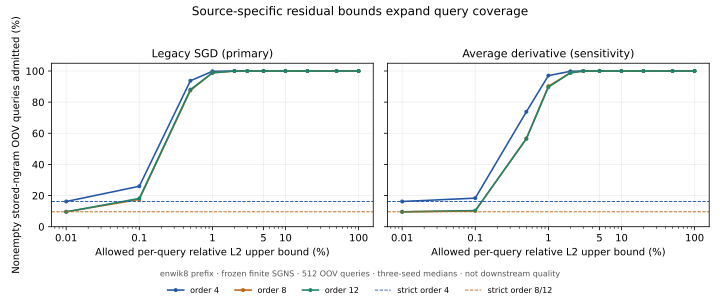

# Actual-source error budgets extend partial-group query coverage

On 2026-11-04, reuse 18 finite, already-trained enwik8-prefix SGNS checkpoints:
orders 4/8/12, seeds 3/7/11, legacy and average-derivative conventions. No new
training or data downloads. The nine legacy known/OOV traces match the earlier
FAISS study's arrays. Source/checkpoint/corpus hashes are verified before use.

The strict certificate is weight-independent and refuses incomplete groups.
The new optional sidecar instead bounds each query's actual-source residuals,
including native reduction/cast rounding. It permits only a user-declared
aggregate-L2 budget and retains no original-row fallback. These are **stored
n-gram component aggregates**, not semantic quality, complete model-output error
or LLM memory/gate results. Missing n-gram types are omitted identically in all
references; coverage does not mean all possible n-gram types are stored.

## Fixed-budget OOV coverage

All traces contain 512 nonempty held-out OOV bags. Three-seed medians:

| Convention / maximum order | Strict domain | 1% relative-L2 bound | 2% bound | 3% bound | 5% / 10% bound |
| --- | ---: | ---: | ---: | ---: | ---: |
| Legacy / 4 | 16.21% | 99.80% | 100% | 100% | 100% |
| Legacy / 8 | 9.57% | 98.83% | 100% | 100% | 100% |
| Legacy / 12 | 9.57% | 98.83% | 100% | 100% | 100% |
| Average / 4 | 16.21% | 97.07% | 99.80% | 100% | 100% |
| Average / 8 | 9.57% | 90.23% | 98.83% | 100% | 100% |
| Average / 12 | 9.57% | 89.65% | 98.83% | 100% | 100% |

All returned mean and sum errors fall within their computed absolute bounds;
all mean relative errors fall within their computed relative bounds, including
queries that fail tighter budget gates. Strict accepted mean-query native bytes
remain unchanged. This is a source-specific guarantee under the documented
floating-point assumptions, not an extension of the uniform exact-domain theorem.
The [raw report](report.json) includes every checkpoint, query error/bound, all
12 predeclared budgets, oracle eligibility and failed budget selections.

For all three legacy seeds, a 2% bound admits every sampled OOV query; the largest
observed relative errors are 0.604% / 0.637% / 0.614% at orders 4/8/12. Average
derivatives are weaker: 3% admits all sampled queries and the corresponding worst
observed errors are 1.118% / 1.315% / 1.293%. The budget limits the **upper bound**,
not a validation-selected empirical average, cosine or downstream-loss change.



## Complete capacity and construction

Sidecar arrays occupy `8*N + 16*G` bytes; including JSON they occupy about
92 / 177 / 194 KiB at orders 4/8/12. Count them together with native rows,
forwarding IDs, domain/manifest and unchanged word/output FP32 rows and registry.
Compared to the same complete raw FP32 model, three-seed median storage savings
are **29.74% / 63.01% / 66.28%** in the primary legacy family. These are not
additional savings over the prior selected FAISS codecs. No fallback source
rows are retained; an above-budget query remains refused.

Each checkpoint has a fresh worker, but its high-water RSS includes Torch,
resident source weights, native maps, build, oracle and query assessments. The
optional sidecar uses two temporary `G*d*8` files. Its construction report and
scratch costs are separate from the earlier complete-builder 31.21x result;
this experiment makes no isolated build-RSS or hard-memory-cap claim.

## Query cost and frozen batching control

The first correct bounded implementation takes about 2.0–2.3 seconds to assess
512 OOV bags, against about 9–10 milliseconds for the source FP64 reference.
The strict path's shorter trace contains only its accepted subset, so its
sub-millisecond/millisecond timing is a different scope. Keep these slow
results in [report.json](report.json).

The batched follow-up gathers all representative rows and computes interval
norms across a whole schedule. Scalar outward rounding and zero-residual groups
retain the original per-group rounding order. The
[paired retiming](retiming.json) compares nine primary legacy checkpoints,
both known/OOV traces, two warmups and five seed-42 interleaved repetitions.
All 18 checkpoints, including sensitivity controls, compare candidate mean
vectors and every bound/domain array byte-for-byte. Timings/equality records
and three-seed medians are in [summary.json](summary.json).

| Maximum order | Reference OOV p50 | Batched full OOV assessment p50 | Median per-seed improvement |
| --- | ---: | ---: | ---: |
| 4 | 2,050.3 ms | 111.7 ms | 18.50x |
| 8 | 2,109.9 ms | 120.9 ms | 17.46x |
| 12 | 2,277.5 ms | 146.5 ms | 15.75x |

P50 columns are medians of the three per-seed p50 values. Improvement is the
median of the three paired ratios, rather than the ratio of column medians.

Even after batching, source FP64 queries remain faster. Coverage/capacity
improvements therefore have explicit per-query checking cost; this is not a
universal latency improvement, exclusive service or cold-disk benchmark.

## Sources, validation and failures

First implementation/protocol source: `da2bce4d12cfd185cfcf43540a9d442d36f9ea24`.
Final batched implementation/control source: `e55927279735a12759163a3c762e16e74b96772a`.
[Protocol](../budgeted_bag_protocol_20261104.md),
[CLI/API and bound derivation](../budgeted_bag_queries.md),
[benchmark commands](reproduction/run.sh), [retiming commands](reproduction/retime.sh).
Runtime/compiler/source/native hashes are in [environment.json](environment.json)
and raw reports. All work is CPU-only on a shared warm AMD EPYC 7742 host;
no GPU programs were inspected or changed, and no monetary/energy measurement.

Local full suite: 193 tests, 100 optional-dependency skips; installed NumPy-only
wheel runs the new source-bound path outside the checkout. All nine remote
targeted tests pass without skips. Raw logs are in
[tests/](tests/). Exact-fraction fixtures test sum/mean bounds through
cancellation, subnormal FP32 values, incomplete groups and unequal counts.

The initial source snapshot lacked a compiled native library, stopping the first
worker before query assessments. A first batching revision then changed last-ULP
bound values by skipping zero-group additions; its strict comparison stopped
before timing. Both failure logs are preserved in [failures/](failures/); native
compilation and the original outward-rounded addition order resolve them. No
error-budget thresholds were changed or failed query selections removed.

Public files contain metrics/hashes, not corpus text, source/sidecar row arrays
or weights. The full cached inputs remain necessary to rerun source queries.
The public summary can be validated and regenerated without training or GPUs:

```bash
python docs/budgeted_bag_evidence_20261104/verify.py
python -m tools.analyze_budgeted_bags \
  --report docs/budgeted_bag_evidence_20261104/report.json \
  --retiming docs/budgeted_bag_evidence_20261104/retiming.json \
  --output-dir artifacts/budgeted-bag-redrawn --plots
```

Matplotlib is needed only for `--plots`. This author-run follow-up establishes
neither third-party adoption nor a universal final-vector similarity premise.
