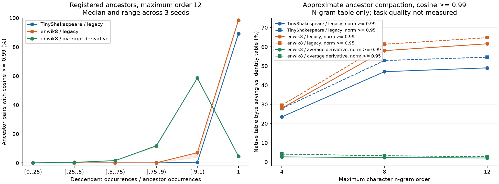

# Conditional similarity of prefix/suffix ancestors

Completed 2026-11-09. **Some registered descendants and their proper prefix or
suffix ancestors reach cosine >=0.99, substantially more often than matched
unrelated pairs.** This concerns containment in a prefix/suffix tree, including
immediate parents. Siblings sharing a fragment are a different relation.
These are post-hoc analyses of 27 existing finite character SGNS models, not
new training, a universal spelling rule or a first-discovery claim.

## Complete primary results

All entries are medians of seeds 3/7/11. Pair99 is cosine >=.99 divided by the
enumerated relation's pairs. The unrelated control holds the descendant fixed
and substitutes an ancestor of the same length and log2 frequency bin; its
fraction uses the matched subset. Source-matched fractions, counts, unmatched
cases and residual frequency imbalance are in [summary.json](summary.json) and
every source analysis. No vector values select controls.

**Savings are approximate n-gram-only native file savings relative to the same
source's v3 identity native file.** Both include native map/block/codec costs at
64-row blocks. They exclude key registries, separate word/output weights and
the whole model. No held-out task evaluation was run at these new thresholds.

| Corpus / update convention | Max order | Parent pair99 | All-ancestor pair99 | Descendant-fixed unrelated pair99 | File saving, norm >=.99 | File saving, norm >=.95 |
| --- | ---: | ---: | ---: | ---: | ---: | ---: |
| TinyShakespeare / legacy | 4 | 19.09% | 12.44% | 0.50% | 23.48% | 27.80% |
| TinyShakespeare / legacy | 8 | 49.67% | 29.27% | 2.59% | 47.03% | 52.84% |
| TinyShakespeare / legacy | 12 | 51.97% | 31.99% | 3.77% | 49.00% | 54.57% |
| enwik8 / legacy | 4 | 20.74% | 13.44% | 0.62% | 28.02% | 29.54% |
| enwik8 / legacy | 8 | 57.49% | 33.04% | 2.37% | 57.99% | 61.29% |
| enwik8 / legacy | 12 | 61.73% | 36.59% | 3.11% | 61.54% | 64.73% |
| enwik8 / average derivative | 4 | 4.64% | 3.06% | 0.27% | 2.64% | 4.12% |
| enwik8 / average derivative | 8 | 4.78% | 2.51% | 0.65% | 2.31% | 3.24% |
| enwik8 / average derivative | 12 | 4.49% | 2.26% | 0.75% | 2.06% | 2.78% |

Every compaction uses cosine >=.99 together with the stated symmetric norm
ratio. Representatives must be retained ancestors, so each replacement is
checked against its final representative rather than accepted through a chain
of local matches. The approximation changes original vectors; native reopening
preserves the approximation's bytes. Average-derivative results are much weaker
and do not show increasing savings with maximum order. Large legacy savings
cannot be generalized to ordinary training or Engram.



The left panel uses all proper ancestors at maximum order 12. Shading is the
three-seed range, not a confidence interval. Bins contain different frequency
and length mixtures: the average-derivative curve is notably nonmonotonic near
coverage 1. Shared coverage alone is insufficient. All bin denominators and
seeds remain in `ancestry_diagnostics.coverage_cells`. [SVG](ancestry.svg),
[plot source](plot.py), [plot environment](plot-environment.json).

## Corrected frequency and length interpretation

Use `f_descendant / f_ancestor` to measure the ancestor's occurrence coverage
by the descendant. Proper-ancestor coverage is at most 1; counts include host
word multiplicity. Fewer ancestor-only exposures are consistent with less
divergent updates. The descriptive conditional Spearman results separate both
endpoints:

| Covariate | Held fixed | Legacy, both corpora: seed-median rho range | enwik8 average derivative: range |
| --- | --- | ---: | ---: |
| Ancestor frequency | Both lengths, descendant frequency bin | -.588 to -.518 | -.483 to -.157 |
| Descendant frequency | Both lengths, ancestor frequency bin | +.326 to +.394 | +.380 to +.478 |
| Coverage fraction | Both lengths | +.556 to +.639 | +.273 to +.484 |
| Descendant length | Ancestor length, both frequency bins | -.133 to +.073 | -.079 to -.020 |
| Descendant frequency inside identical incidence | Both lengths | +.572 to +.809 | +.704 to +.748 |

Thus a negative frequency association must specify ancestor frequency.
Descendant frequency has the opposite conditional association. Inside identical
incidence, more training is consistent with shared updates overcoming independent
initialization residuals. Saved enwik8 initialization and accumulated-update
diagnostics support this interpretation; TinyShakespeare initial rows were not
retained and are not reconstructed here. Length is an unstable proxy after
conditioning. Long-tail status alone does not guarantee similarity.

Each rho is an observation-weighted average over eligible strata (>=50 valid
pairs), summarized across seeds. All groups, including null/constant/small
strata, are archived. Pairs reuse vectors and are dependent: no independent-pair
significance tests or causal claims. Coarse frequency controls and alternative
update strengths/convergence limit interpretation.

For TinyShakespeare order 12 seed 3, there are 91,719 ancestor pairs. Holding
each descendant fixed with equal matched candidate counts, 9,152 of 13,732
descendants have a >=.99 ancestor candidate, versus 1,827 with an unrelated
candidate. This removes unequal-best-of-many comparisons but does not ensure
that every candidate can be retained. Actual .99/.99 direct-to-retained
compaction merges 7,303 of 14,132 rows, saves 48.92% native bytes and affects
25.27% source occurrence mass. Weighted row Frobenius distortion is 0.879%,
a vector metric rather than a task-loss percentage. Each fidelity report keeps
tail relative errors; angle and norm gates cannot guarantee semantic quality.

## Sources, controls and disclosure order

- Nine [TinyShakespeare references](../native_ngram_evidence_20261018/trained-reference.json):
  128 dimensions, orders 4/8/12, seeds 3/7/11, legacy input gradients.
- Eighteen [enwik8 checkpoints](../cross_corpus_evidence_20261102/training-report.json):
  same orders/seeds/dimension, 2,000 steps of 256 SGNS pairs, LR .05 and five
  negatives, both legacy and standard average derivatives. Training vocabulary
  contains 1,200 words from the existing 200,000-token prefix. This is a small
  finite study, not converged full-corpus pretraining.
- Enumerate all registered proper prefix/suffix ancestors of length >=2;
  deduplicate pairs and retain immediate-parent results separately.
- Both ancestor-fixed and descendant-fixed controls use exact length,
  floor(log2(count)) bins and 64 metadata-only candidates, choosing the closest
  frequency. Exclude every proper ancestor relation. Best-per-descendant
  comparisons use equal candidate counts with the descendant fixed.
- Float64 cosine, norm and error arithmetic uses original FP32 rows. Zero
  vectors remain separately counted and cannot pass a gate. Source occurrences
  and reproduced sampled SGD exposures remain separate.

The [protocol](../conditional_similarity_protocol_20261109.md) records the
sequence: known aggregate results, fixed initial post-hoc analysis, then the
user's containment clarification and refined all-ancestor specification before
computing new ancestor results. Coverage/initialization diagnostics were
motivated by the initial differing frequency signs. This is exploratory
evidence, not prospective confirmation of an unseen hypothesis.

## Qwen auxiliary boundary

Six existing Qwen3-0.6B/Qwen3.5-4B exact-key tables provide a separate sibling
check, sampled within each of six heads: 3,600,000 comparisons, 7 with cosine
>=.99. These are same-order siblings, not descendants versus ancestors.
Different orders occupy independent heads and projections; raw cross-head
cosine cannot test containment. This appendix neither refutes the character
ancestor result nor establishes transfer to Engram. Complete counts, seeded
initialization diagnostics and source hashes are in
[qwen-auxiliary/report.json](qwen-auxiliary/report.json).

## Audit and reproduction

```bash
python -S docs/conditional_similarity_evidence_20261109/verify.py
```

The stdlib verifier checks file integrity, source report/row/checkpoint/corpus
provenance, analysis/source/protocol snapshots, count partitions, stored rho
arithmetic, matched/unmatched accounting, logged native reconstruction
assertions, storage invariants and derived medians. It does not recreate
unpublished vectors, repeat cosine measurements, or independently reconstruct
the logged native hashes from raw rows.

Commands, source commits, Python/NumPy/PyTorch/OS/CPU details, threads, costs and
limitations are in the three dataset `report.json` files. This work used existing
CPU resources and assets, with no new training, GPU work or paid service.
Snapshots are `f2b2727` for primary analyses and `50b02aa` for Qwen siblings;
later tests clarify the candidate-count contract without changing measurements.
`run.sh` includes the initial enwik8 command, whose superseded character outputs
are not archived here. `refined-run.sh` and `refined.log` identify the final
18 primary enwik8 analyses. Source modules are under `runtime/<commit>/`;
weights, raw keys and corpora are not redistributed. Repeat measurements using
the matching snapshot, original assets and the command in each report. Build
the included native CPU source into a shared library first.

This supports vector-verified, ancestor-constrained approximate sharing with
explicit failure cases. Exact-byte codecs and incidence-certified aggregate
compaction have separate contracts; similarity observations do not replace
their proofs or establish superiority to unconstrained clustering/PQ.
