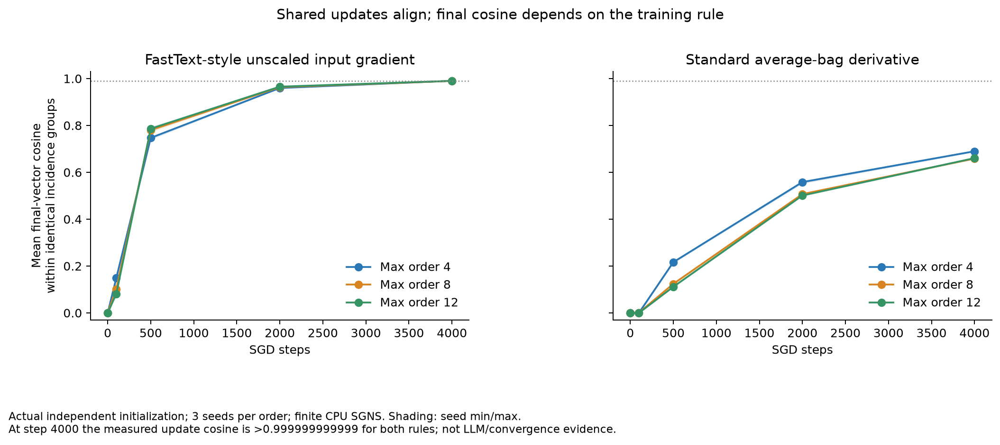
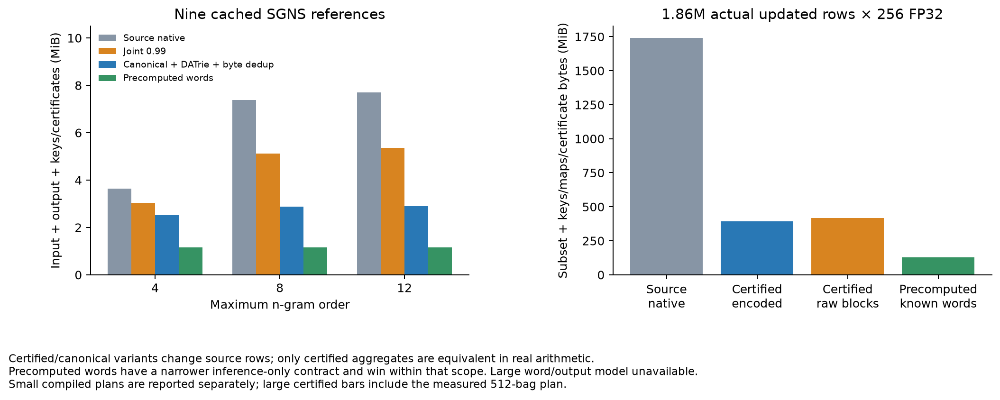
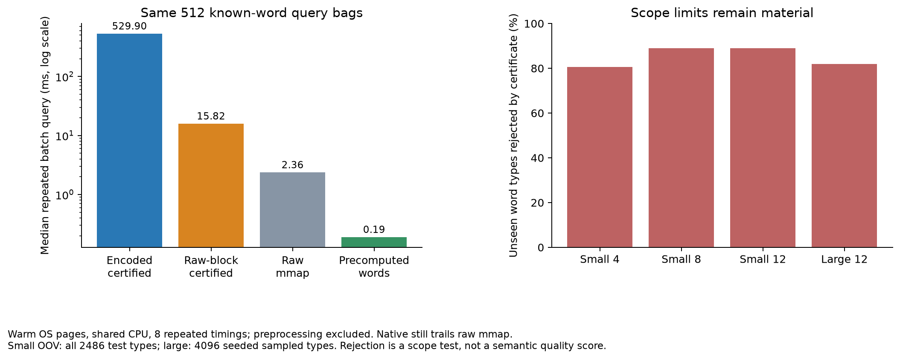
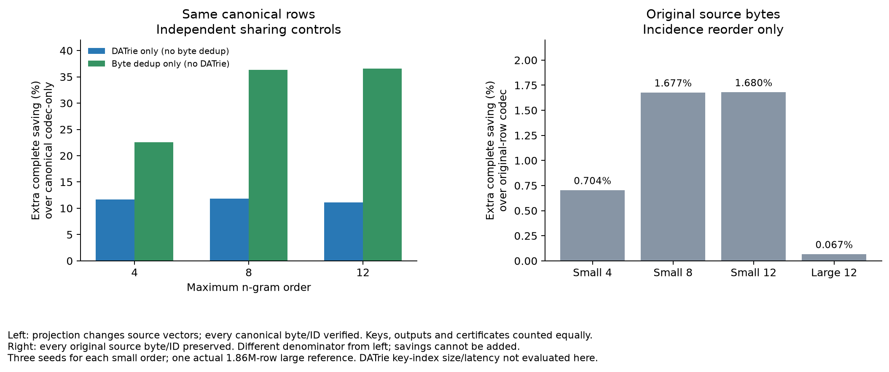

# Co-training groups: parameterization, capacity and query evidence

Started 2026-10-31; follow-up construction/install checks continued on 2026-11-01.
All remote work used CPU under `/llm-align/duyimin/ngram-cotraining-20261031`.
`CUDA_VISIBLE_DEVICES=''`; no GPU program was inspected or stopped.

The stronger result is **certified aggregate equivalence**, not a universal
99%-cosine claim. Equal complete bag-incidence/multiplicity signatures identify
parameters whose within-group residual cannot affect certified sums/means.
The [method/API](../cotraining_groups.md) specifies the conditions and contracts.
Original vectors change under projection; arbitrary n-gram queries are not
preserved. The original row-byte storage path remains a separate option.

## Actual training dynamics and matched parameterization

18 new CPU SGNS models: independently trained maximum orders 4/8/12, seeds
3/7/11, two input-gradient rules, 64 dimensions, 4,000 steps × 128 pairs each.
They use contiguous 80/10/10 word-token splits of cached TinyShakespeare,
training-only vocabulary (1,200 words, minimum count 5), five negatives,
frequency exponent 0.5 and sparse SGD LR 0.05. Both rules average the forward
bag; the FastText-style rule leaves input-row gradients unscaled, while the
standard rule differentiates that average. Equal step counts/LRs do not imply
equal effective input updates or equal convergence.

Every checkpoint compares final vectors with **actual stored initialization**,
actual updates and sampled center events. Each independently initialized model
is paired with grouped parameters on identical samples/negatives. Dividing the
shared gradient by group size preserves the per-original-row update. The FP64
optimizer differential test checks the bag function and mean trajectory;
FP32 training accumulates a small numerical divergence that is reported.

| Max order | Final mean cosine, FastText-style | Final mean cosine, average derivative | Actual update cosine, both rules |
| --- | ---: | ---: | ---: |
| 4 | 0.99038 | 0.68987 | >0.999999999999 |
| 8 | 0.98990 | 0.65867 | >0.999999999999 |
| 12 | 0.99031 | 0.66059 | >0.999999999999 |

These are three-seed means of identical-incidence pairs, **not all spelling
neighbors**. All nonpadding input rows changed in the final new checkpoints.
Maximum measured initial-offset drift is about 1.83e-6. Matched tied training
has up to 4.33e-5 global aggregate error against the independent FP32 run.
Its held-out known-word SGNS objective differs by at most 2.06e-8 relatively,
with unchanged sampled context discrimination in all 18 cases. This later
quality check is a **post-run audit**, not validation selection or a semantic,
perplexity, convergence or LLM-memory result.

Sources: [legacy](legacy-report.json), [average](average-report.json),
[post-run quality/materialization audit](final-audit.json). The protocol files
were saved before each primary run. The shared-gradient identity follows from
the chain rule; related-work novelty has not been established by these runs.

## Existing trained checkpoints and the original DATrie planner

Nine cached 128-dimensional SGNS models from the earlier held-out study use
orders 4/8/12 and three seeds. These are separate checkpoints from the new
64-dimensional training-dynamics models. Projection uses **training bags only**.
Every native artifact verifies every declared original ID's decoded canonical
or representative bytes. Production DATrie prefix/suffix callbacks and actual
mark/compact export are used for `canonical-datrie-exact`, not a substitute trie.
That earlier variant also enabled **global byte deduplication after planning**;
its combined savings must not be attributed to DATrie alone.

| Max order | Certified-group saving over same-codec source native | Canonical + DATrie + byte dedup saving | Canonical aggregate global relative error |
| --- | ---: | ---: | ---: |
| 4 | 30.61–30.62% | 30.62% | 6.44–6.49e-8 |
| 8 | 61.02–61.03% | 61.01–61.02% | 9.88e-8–1.00e-7 |
| 12 | 62.38–62.39% | 62.38% | 1.01–1.03e-7 |

Costs include the actual input table, manifests/certificate, output FP32 payload
and word/n-gram keys. Those common files were subsequently materialized and
their byte totals checked exactly against the primary accounting. Compiled
schedules are additional memory and are explicitly reported. These percentages
are **aggregate-domain model transformations**, not original-vector lossless
compression. Known-word test objective changes are within about 4.1e-10
relatively; this evaluation excludes OOV centers/targets (about 76% test token
coverage). Arbitrary unseen compositions have a different contract.

The follow-up **planner isolation** uses the same canonical matrix, codec,
registered keys, output rows and certificate in each of three layouts. The
DATrie-only variant disables global byte dedup; the dedup-only variant does not
use a structural planner. All original logical IDs decode to the same canonical
bytes, verified for every row. Savings below are relative to the canonical
codec-only complete cost, **not relative to the original trained source**.

| Max order | Full input rows | DATrie survivors | Byte-dedup unique rows | DATrie-only extra complete saving | Byte-dedup-only extra complete saving |
| --- | ---: | ---: | ---: | ---: | ---: |
| 4 | 6,445 | 4,679 | 3,903 | 11.70–11.71% | 22.56–22.57% |
| 8 | 14,487 | 8,283 | 4,247 | 11.81% | 36.29% |
| 12 | 15,189 | 8,804 | 4,247 | 11.08% | 36.55–36.56% |

Thus the original mark-compact planner has a measurable contribution, while
global byte dedup is the stronger storage control on these canonical tables.
These gains overlap and cannot be added. This experiment evaluates planning,
not DATrie key-index size or key-lookup latency; the common JSON key registry is
counted equally. [Isolation report](planner-isolation-report.json),
[pre-run protocol](planner-isolation-protocol.json), source `29b2c1f`.

The truly row-byte-preserving control only reorders source rows by incidence.
On these same nine checkpoints it adds **0.70–0.71%, 1.67–1.68%, and
1.67–1.69%** complete saving at orders 4/8/12, respectively. All original row
bytes/IDs are checked. Keep that modest exact gain separate from projection.
Sources: [cached](cached-report.json), [lossless small layout](layout-small-report.json).

On the actual 1.86M-row source, the same byte-preserving incidence reorder
reduces complete bytes from 1,824,771,269 to 1,823,553,399: just **0.06674%**
extra saving. Every one of the 1,855,907 source rows retains its original ID and
bytes. This negative-scale control rules out treating incidence locality alone
as the source of the much larger certified-projection savings.
[Large lossless layout](layout-large-report.json), source `7925dbd`.

## Actual 1.86M-row capacity and native query costs

Reuse **1,855,907 actually updated rows × 256 FP32**, from the prior finite
enwik8 SGNS run. Three finite rare-center-coverage epochs are not convergence
evidence. The separately registered subset excludes 5,014 unchanged rows, with
the original training-ID map retained. Source corpus/table/key/ID hashes are
checked. Word/output model weights are unavailable for this large reference.

142,308 registered word bags yield **360,088 exact incidence groups**: 80.60%
fewer n-gram parameter slots. This is a grouping opportunity; a 1.86M-row
grouped model was not retrained. Construction peaks at **5,555 MiB RSS**, so
the current Python certificate builder is not a bounded-memory algorithm.

| Layout / scope | Complete measured/count-verified bytes | Repeated 512-bag query median |
| --- | ---: | ---: |
| Source native subset + common keys/IDs | 1,824,772,214 | 737.9 ms in primary trace |
| Certified encoded subset + plan | 413,136,243 | 529.9 ms in paired follow-up |
| Certified raw native blocks + plan | 436,343,333 | 15.82 ms in paired follow-up |
| Original raw mmap subset + common keys/IDs | 1,936,725,580 | 2.36 ms in paired follow-up |
| Precomputed known-word subset means + word keys, raw | 147,378,897 | 0.19 ms warm raw-table selection in paired follow-up |
| Precomputed known-word subset means + word keys, encoded | 136,194,844 | Encoded query latency not measured |

The source-native primary timing is a separate process/run; the paired follow-up
uses exactly the same original query-ID hash and compares encoded/raw certified,
raw mmap and precomputed serving. Raw native blocks are **33.50× faster** than
encoded certified blocks on that trace, costing **5.62%** more complete bytes.
They still trail raw mmap by about **6.70×**. Query samples exclude compilation,
follow byte verification, use warm OS pages on a shared CPU and do not establish
exclusive, cold-page, memory-pressure or end-to-end LLM serving performance.

Every canonical row is verified under encoded and raw native layouts; their
decoded hashes are identical. On 512 selected held-out known-word bags,
aggregate relative error is **4.32e-8**. Individual source vectors change:
global row error is **8.70%**, maximum row-relative error **104.01%**. The small
aggregate error cannot be advertised as small individual-vector error.

Sources: [large primary](large-report.json), [paired raw-block study](raw-block-evidence.json),
[precomputed baseline](final-audit.json). Native byte identity here is to the
declared **canonical** rows, not the original trained rows. Complete costs
cover this subset, keys, original training IDs, maps, certificates, manifests and
the stated plan; they exclude the unavailable full SGNS word/output model.

## Strong baselines and applicability limits

Directly precomputed known-word vectors need about **1.21 MB** including output
rows and word keys on the small models, and beat grouped serving within their
restricted domain. The large known-word subset mean table needs about **136 MB**
encoded. Precomputation does not retain per-n-gram SGD parameter trajectories
or answer general certified group combinations. It must nevertheless be the
serving baseline when the application only requests known words.

For unseen test words, the small certificate rejects **2,002/2,486 types** at
order 4 and **2,212/2,486** at orders 8/12. The large audit rejects **3,359/4,096
seeded sampled types** from 21,967 OOV types. Some new combinations certify;
others are refused. Their unconditional projection error is also recorded,
but is not a downstream semantic score. No automatic claim about independently
gated Engram heads, sufficiently trained LLM memories or open-vocabulary quality
follows from a shared source word or from these SGNS experiments.

The randomized group-size control redistributes **actual learned rows** and
does not preserve registered word aggregates. It is a diagnostic counterfactual,
not random-vector compression evidence.

## Reproduction and implementation checks

Primary experiment source: `5237b7c`; public API and original-row layout source:
`7ff4a90`; post-run audit: `42ecfcb`; raw native block path: `6d385ca`.
Later sequential ID-map writes and initialization-lifetime fixes have their own
commits/checks. Reports record invocation paths, environment and source/data
hashes; exact `python -m` commands are retained in the scripts. The
[reproduction scripts](reproduction/) use only local cached corpora
and existing checkpoints. Raw text/weights are kept local; TinyShakespeare's
license has not been independently verified, and enwik8 is Wikipedia-derived.
No monetary/energy cost was metered.

The first large lossless-layout attempt was preserved, including a duplicated
launcher failure and any explicitly interrupted **own CPU export**. Reordered
ID maps now stage `8*N` bytes and write sequentially instead of one tiny seek/
write per row. The final lossless-layout evidence is reported separately; a
failed/unfinished earlier attempt is not rewritten as a success.

The grouped constructor no longer retains the dense initialization in a class
closure. A weak-reference lifetime test checks its release. Gradient tests cover
real sparse SGD steps, unequal multiplicities, other host words, padding,
incomplete groups and incorrect unscaled tying. Export tests cover cleanup,
existing outputs, artifact/certificate mismatch and raw-block bit preservation.
Both API namespaces and installed-wheel use are checked; reader formats and
legacy imports remain compatible. Final source checks and hardware details are
saved alongside this report.

Final Linux checks at `80d3a01`: **155 tests run, 17 skipped**, followed by wheel
build, installation into a separate target and execution of the public API
example outside the source checkout. [Tests](final-full-tests.txt),
[wheel build](final-wheel-build.txt), [install](final-wheel-install.txt),
[installed example](final-installed-example.txt), [hardware/provenance](environment.json).
The CPU is AMD EPYC 7742; Python 3.11.15, PyTorch 2.11.0+cu130 and NumPy 2.2.6.
CUDA was disabled throughout. The captured source status includes an untracked
`core` file from earlier tests; tracked implementation hashes are recorded.

The interrupted first layout export and duplicate-launch failure are retained
in the [attempt record](layout-first-attempt.json) and [failure log](layout-first-attempt.log).
Only the separately completed sequential-map run supplies the final result.

## Figures from the measured reports

The [plot source](plot_evidence.py) reads the checked-in JSON. Each figure also
has an SVG with the same basename for export; no vectors or curves are invented.
