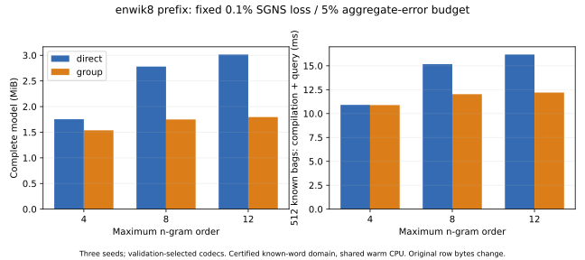
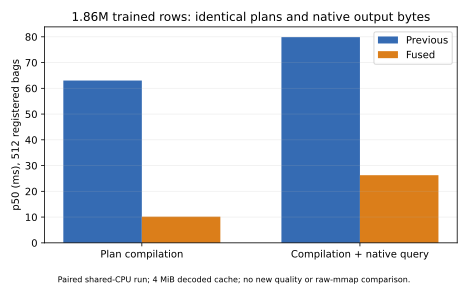

# Independent-corpus replication and fused total-query evidence

Completed 2026-11-02. On a fixed enwik8 prefix, incidence compaction retains
additional complete-model savings after a full FAISS codec comparison:
**12.33% / 37.12% / 40.47% at maximum orders 4/8/12**, within the predeclared
0.1% SGNS loss-change budget. Fused original-ID counting makes high-order
registered-bag compilation plus query faster than the selected direct codec
on these shared-CPU traces. A separate production native retiming improves
the unchanged 1.86M-row certified path **3.04×**, with identical plan/output
bytes. These are finite SGNS and certified-domain results; original-row
lossless storage, arbitrary OOV serving and LLM quality have separate contracts.

## Matched training on a second corpus

The [protocol](../cross_corpus_protocol_20261102.md) was saved before training
or fitting. Use the cached enwik8 ZIP, first 4 MiB of member `enwik8`, unchanged
lowercase regex, then exactly the first 200,000 tokens. XML/wikitext metadata
is retained. Contiguous train/validation/test splits are 160,000/20,000/20,000
tokens; the 1,200-word vocabulary and incidence groups use training only.
This is distinct from TinyShakespeare but shares enwik8 with the previous
large capacity study. It is not a cleaned prose corpus or a never-used dataset.

Train orders 4/8/12, seeds 3/7/11, 128 dimensions, 2,000 steps of 256 SGNS
pairs, LR 0.05 and five negatives: **18 dense/tied pairs** across legacy and
standard average-derivative conventions. Each pair shares initialization,
sampled centers and negatives. Final identical-incidence pair cosine,
averaged over three seeds:

| Maximum order | Legacy cosine | Average-derivative cosine |
| --- | ---: | ---: |
| 4 | 0.998225 | 0.849104 |
| 8 | 0.997730 | 0.801538 |
| 12 | 0.997708 | 0.796242 |

Final accumulated update-pair cosine stays above 0.999999999998 across these
runs, while initialization residuals affect final weights. This replicates the
shared-update mechanism; it does **not** establish 99% similarity for all
prefix/suffix vectors. The optimizer correction and complete incidence domain,
rather than a similarity threshold, justify the matched compact model.

All 18 paired held-out tests use 8,192 samples. Maximum absolute relative
SGNS-loss difference is **5.79e-8**, and context-discrimination differences are
zero. Maximum registered aggregate relative L2 is **4.97e-5** in FP32.
Test token vocabulary coverage is **65.355%**, so these objectives do not
measure the omitted vocabulary or semantic quality. Neither convergence nor
large grouped-model retraining is claimed. [Training report](training-report.json),
[training log](training.log), [derived summary](summary.json).

## Complete codec comparison at fixed quality

Evaluate all nine new legacy dense checkpoints. Fit 19 configurations per
direct/group/full-domain-hybrid family: FP32, FP16, SQ4/6/8, full-vector
clustering at 256/512/1024/2048 centers, PQ8x4/8x8/16x8/32x8/64x8,
OPQ8x8/32x8/64x8, and RQ2x8/4x8. This gives **513 base candidates**.
Audit **171 direct encoded-byte dedup alternatives** without refitting:
68 save complete bytes and enter evaluation; 103 prefer the original direct
layout; none fail. Thus **581 candidates** participate in validation selection.

Select the smallest complete model on validation with SGNS loss increase at
most 0.1%, discrimination decline at most 0.5 percentage point, and registered
aggregate relative L2 at most 5%. Include word/output weights, key registry,
codebooks, codes, maps/certificates and all hybrid fallback rows; fixed trace
plans are separate. All primary selections are SQ6. Three-seed medians:

| Maximum order | Direct complete bytes | Certified complete bytes | Extra saving | Direct compilation + query | Certified compilation + query |
| --- | ---: | ---: | ---: | ---: | ---: |
| 4 | 1,838,068 | 1,611,456 | 12.33% | 10.90 ms | 10.89 ms |
| 8 | 2,915,142 | 1,832,905 | 37.12% | 15.17 ms | 12.03 ms |
| 12 | 3,161,168 | 1,881,996 | 40.47% | 16.18 ms | 12.20 ms |



All primary test point estimates pass. The paired within-text token-block
intervals also lie within the primary loss/discrimination thresholds; these
are exploratory intervals, not independent-corpus or simultaneous guarantees.
The tighter **0.01%** budget has **four test point failures among 27 selected
family/checkpoint pairs**; all 0.5% point estimates pass. Validation selection
is never revised using test results. Full selections, intervals and failed
quality candidates remain in [codec-analysis.json](codec-analysis.json) and
[merged-report.json.gz](merged-report.json.gz).

This result establishes complementarity within a fixed finite codec grid and
the registered domain. Same-codec group reconstruction remains less accurate:
selected direct aggregate relative L2 spans 1.88–2.70%, versus 2.13–3.34% for
groups. The complete quality budget permits this tradeoff. This is not strict
accuracy dominance over FAISS or all quantization/tuning methods.

### Stronger restricted control and OOV limits

Precomputed known-word FP32 inference costs **1,240,878 complete bytes** and
about **0.028–0.034 ms** per 512-word gather. It remains smaller and much faster;
it does not retain arbitrary n-gram lookup, OOV or matched training. The separate
compact certificate ablation is included in the analysis, not substituted into
the timed original certificate implementation.

Certified-only OOV accepts **83/512, 49/512, 49/512** nonempty bags at orders
4/8/12. Its timings include rejection and are not full-domain speedups. Hybrid
accepts all 512 but retains original nonsingleton FP32 fallback rows:

| Maximum order | Hybrid complete bytes | Direct OOV total query | Hybrid OOV total query |
| --- | ---: | ---: | ---: |
| 4 | 3,627,328 | 11.26 ms | 14.35 ms |
| 8 | 9,174,089 | 12.38 ms | 15.60 ms |
| 12 | 10,374,668 | 12.45 ms | 15.76 ms |

Full-domain hybrid is larger/slower than direct here. No rejected work is
counted as useful output. [All dedup audits](code-dedup-report.json.gz),
[capacity/error frontier](frontier-capacity-error.svg),
[capacity/SGNS frontier](frontier-capacity-sgns.svg).

## Fused query compilation and production native path

Share one original-ID count between certification and weighted schedule
construction; apply batching fairly to direct and encoded-byte-map controls.
Keep fallback ordering, original representatives, weights and denominators.
Immutable byte-backed partition arrays allow a cached mapping digest; native
compilation no longer scans the entire table for representatives or its hash.
This combined change adds no new distortion to the already-selected codecs.

The new-corpus 27-candidate paired retiming reduces certified known-word
compilation plus FAISS query **1.82–1.86×** relative to the prior batch path.
Direct also benefits from fused counting; the table above uses fresh direct
measurements. All saved schedules and all 1,200 registered outputs per candidate
are byte-identical. [Cross-corpus query samples](cross-query-report.json).

On the previous nine frozen TinyShakespeare references, the same 27 selected
SQ6 variants retain identical bytes and improve certified total query another
1.86–1.89×. New direct/group totals are 9.67/9.85, 12.62/10.63 and
12.79/10.66 ms at orders 4/8/12. High orders improve versus direct, while
4-order certified queries remain slightly slower. This follows the
[earlier scalar-to-batch result](../faiss_schedule_evidence_20261102/README.md);
it does not overwrite that run or reuse its timing numbers as new controls.
[Frozen query report](frozen-query-report.json), [run log](final-retiming.log).

Separately reuse the actual **1,855,907 × 256 FP32** trained table and its
published **512-bag** trace, checked against the previous trace SHA256. Use the
same native C weighted reducer and certified raw blocks with a 4 MiB decoded
cache. Old/new plans, summaries and native outputs are byte-identical:

| Native p50 | Previous | Fused | Improvement |
| --- | ---: | ---: | ---: |
| Plan compilation | 63.018 ms | 10.167 ms | 6.20× |
| Compilation + native query | 79.866 ms | 26.268 ms | 3.04× |

Precompiled replay is 15.679 ms. The 198,904-byte plan still represents 21,747
original occurrences with 15,892 weighted group occurrences. No new raw-mmap
total-query, OOV, isolated RSS or original-row-lossless comparison is added.
The [native protocol](../native_fused_plan_protocol_20261102.md),
[samples](native-retiming.json), [trace verification](large-native-trace.json)
and [log](native-retiming.log) retain that scope.



## Sources, failures and reproduction

Training source: `5dd15b4` (full SHA in the training report); final engine/native
and frozen query source: `0db92f18eb685d14cafc9a556301b316db41a0a5`;
bounded grid and new-corpus retiming: `a472c23b4b42cdc43d06cd1f990f8e923216c7c8`.
Reference engine: `aa38f3371a1a8ac8e35dd258cb955688f6329fa0`.
Source/function/library, corpus, checkpoint, trace and codec hashes are recorded.

The dispatcher reuses three complete order-4 runs and launches at most three
independent checkpoint jobs, four fit threads each, one query thread per fresh
worker. Retiming uses two warmups, 15 repetitions and seed-42 paired interleaving.
AMD EPYC 7742 shared warm CPU, Linux/glibc 2.35, Python 3.11.15, NumPy 2.2.6,
FAISS CPU 1.15.0, Torch 2.11.0+cu130. CUDA is disabled throughout; GPU programs
are not inspected or changed. Timing comparisons between separate candidates
are descriptive shared-CPU observations, not exclusive service latency.

The [initial fused revision](preliminary-query-report.json.gz) regressed direct
timing; it is diagnostic evidence, while the final counting fix is the evaluated
implementation. The interrupted serial continuation is preserved
in [its note](serial-continuation.txt), and complete original stage provenance
is in [grid-orchestration.json](grid-orchestration.json). A shallow-copy metadata
bug changed the three reused phases' embedded `output_dir` strings in the
combined report. Canonical phase metadata remains unchanged in the separate
orchestration file. [metadata-note.json](metadata-note.json) records the exact
differences. Raw numeric/frozen reports and their hashes are preserved; the
dispatcher source now deep-copies metadata before normalization.

The final remote full suite passes: **171 tests, 17 skipped**, after the grid
completed; [final log](full-tests-after-grid.txt). All **26 targeted tests**
pass without skips; [log](targeted-tests.txt). A prior full run and two isolated
worker retries encountered spawn exit -9 or an empty queue; the baseline
isolated test passed. These modules are unchanged, the final repeat and GitHub
CI pass, but the earlier failure's cause is not established. All failure logs
remain here. Local Python 3.9.6 source tests pass with 99 skips; this is not a
claim of supported package installation on Python 3.9. The supported Python
versions are checked separately by CI.

No monetary/energy metering, cold-disk test, bounded construction-RAM algorithm,
semantic quality, converged large-model training or LLM/GPU performance claim
is included. Publish metrics/hashes only, not corpus text or checkpoints.
The [grid command](grid-command.sh) and reports contain the exact expanded
commands. Training and native replay require the source-linked cached inputs.
The public summary and plots need no weights, training, FAISS, Torch or GPU:

```bash
python -m tools.analyze_corpus_replication \
  --training docs/cross_corpus_evidence_20261102/training-report.json \
  --codecs docs/cross_corpus_evidence_20261102/codec-analysis.json \
  --query docs/cross_corpus_evidence_20261102/cross-query-report.json \
  --native docs/cross_corpus_evidence_20261102/native-retiming.json \
  --frozen-query docs/cross_corpus_evidence_20261102/frozen-query-report.json \
  --output-dir artifacts/cross-corpus-redrawn --plots
```

Plots require Matplotlib. The [verification script](verify_reports.py) checks
the frozen-report hash chain, canonical phase/source hashes, and rejection of
mixed checkpoints, duplicated selections, false byte-equality flags and rejected
registered work. Run `PYTHONPATH=. python docs/cross_corpus_evidence_20261102/verify_reports.py`;
[verification log](analysis-verification.txt). [Manifest](manifest.json) links
all published hashes, the analyzer, verification command and test sources.
