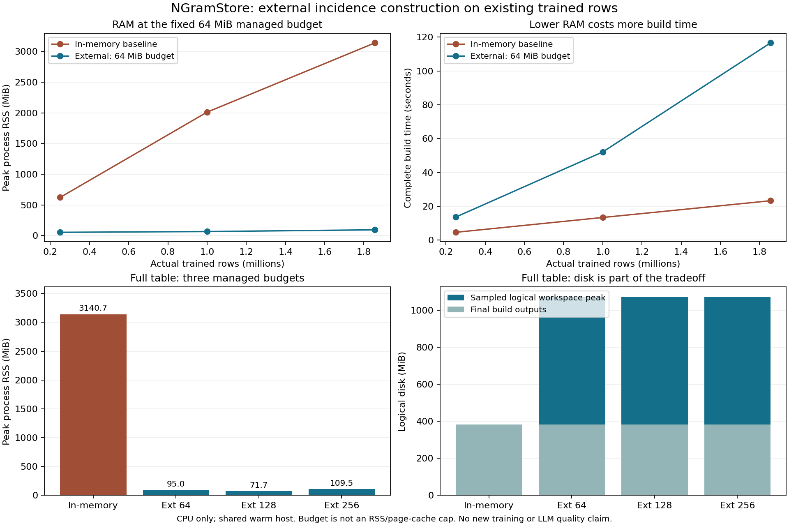

# External incidence construction: lower RAM with unchanged projected bytes

CPU measurements on 2026-11-02 use the existing enwik8 SGNS table, not new
training: **1,855,907 updated n-gram rows × 256 FP32**, 142,308 registered bags
and 6,354,848 occurrences. The 250k/1M scales are actual original-row prefixes
of that table, with every bag retained after filtering. They are not independent
corpora or synthetically replicated rows. The longest full bag has 594 IDs.

The external constructor keeps the previous complete incidence partition and
FP32 means while moving sorting, signature matching and accumulation to disk.
At the default 64 MiB managed budget, full-table process RSS drops from
**3,140.7 to 95.0 MiB (33.06× lower, 96.98% reduction)**. Complete construction
takes **116.6 instead of 23.3 seconds (5.01× longer)**. This is a construction
resource tradeoff; it does not improve compression ratio or prove LLM quality.

| Actual rows | Builder / managed budget | Peak RSS MiB | Complete seconds | Sampled workspace MiB | Final outputs MiB |
| ---: | --- | ---: | ---: | ---: | ---: |
| 250,000 | In-memory baseline | 623.0 | 4.61 | 109.1 | 109.1 |
| 250,000 | External / 64 MiB | 54.7 | 13.62 | 316.3 | 109.1 |
| 1,000,000 | In-memory baseline | 2,012.3 | 13.37 | 278.6 | 278.6 |
| 1,000,000 | External / 64 MiB | 66.9 | 52.12 | 793.7 | 278.6 |
| 1,855,907 | In-memory baseline | 3,140.7 | 23.26 | 382.7 | 382.7 |
| 1,855,907 | External / 64 MiB | 95.0 | 116.58 | 1,071.9 | 382.7 |
| 1,855,907 | External / 128 MiB | 71.7 | 102.48 | 1,071.9 | 382.7 |
| 1,855,907 | External / 256 MiB | 109.5 | 97.26 | 1,071.9 | 382.7 |

All **8 fresh single-threaded workers** completed. All five external builds
compare every mapping, group-size and mean byte with a fresh in-memory baseline
at the same scale. Full-table comparisons cover 14,847,256 mapping bytes,
2,880,704 group-size bytes and 368,730,112 mean bytes per external run. Group
count remains 360,088, the same 80.60% parameter-row reduction as the earlier
study. Hashes index candidates; full signature comparisons resolve collisions.

Managed budget is **not a hard RSS/cgroup or OS page-cache cap**. The 64 MiB
full build exceeds that number in process RSS, and measured RSS is not monotonic
across budgets. The full external accumulator occupies 703.3 MiB of logical
disk. Workspace includes final outputs and is sampled at run/merge/stage
boundaries, not a continuous physical-disk maximum; the in-memory baseline's
workspace is sampled at completion. Final outputs count means, two raw arrays,
the legacy-compatible NPZ and external metadata, excluding the result report.
Input tables/CSR and application keys/weights remain separate costs.

Preparation still uses resident cached JSON registries: **34.51 seconds and
324.5 MiB RSS**, separately measured. It is not a bounded-memory tokenizer or
whole-corpus training pipeline. A separate verifier materializes runtime maps
and scans the previous native artifact: **1.68 seconds and 484.6 MiB RSS**.
Those processes are excluded from the construction RSS above. Native packing
and runtime plans retain their existing memory contracts.

The independent [native verifier](native-verifier.json) checks the exported
legacy reader, every partition entry, all 360,088 means against the earlier
native canonical rows, and the unchanged 512-bag trace. IDs, weights, offsets,
denominators, summary and C-reducer sum/mean outputs are byte-identical.
This comparison is to the **existing projected table**: individual original
source-row bytes change under projection. Only certified complete aggregates
receive the real-arithmetic guarantee, with FP32 rounding separate. There is
no new arbitrary/OOV lookup, query-speed, downstream-quality or DATrie gain.

The first external attempt was interrupted because small bags performed costly
truncate/seek/flush operations on disk. Its completed legacy result and
incomplete logs are retained in [initial-attempt.json](initial-attempt.json),
[initial-results.json](initial-results.json) and `logs/initial-*`. The correction
uses a fixed small-bag byte buffer with spill for larger bags; the forced-spill
test passes. The entire declared grid was rerun. A separate verifier attempt
failed because NumPy integer IDs did not meet the native Python-ID API; its
[failure log](logs/failed-native-verifier.log) is preserved. The corrected
verifier and a changed-mean rejection test both pass.

AMD EPYC 7742, Linux 5.4/glibc 2.35, Python 3.11.15, NumPy 2.2.6 and SQLite
3.51.2; the visible task filesystem reports Ceph. Workers limit OpenMP/MKL/
OpenBLAS to one thread and set `CUDA_VISIBLE_DEVICES=''`. CPU and filesystem
are shared and warm; physical backing storage, exclusive/cold-cache latency,
monetary/energy costs and total OS cache are unmeasured. No GPU was inspected
or manipulated. [Environment](environment.json), [raw report](report.json),
[preparation](preparation.json) and [derived summary](summary.json).

Preparation is pinned to [25ed5e6](https://github.com/initial-d/ngram-store/commit/25ed5e6aba7aaf95460099bbae7b90b2925f2f01),
the full construction grid to [1c0c832](https://github.com/initial-d/ngram-store/commit/1c0c832b50ba4b17087679ca61fdf510620fc401),
and the successful verifier to [9734ec1](https://github.com/initial-d/ngram-store/commit/9734ec191f3820e003a220769e8a492150c294cd).
Source/table/CSR/word/trace/native hashes are preserved in the reports. Weights,
CSR IDs and corpus text are not published here. [Protocol](../external_incidence_protocol_20261102.md),
[reproduction notes](reproduction/README.md), [public CLI/API guide](../external_incidence_build.md).

Remote source `1c0c832` full tests: 178 tests, 17 skips; final verifier targeted
tests: 8, no skips. Final local Python 3.12 NumPy-only tests: 180 tests, 99 skips.
The native verifier and incomplete/mixed-evidence rejection tests pass. Skip counts
reflect unavailable optional integrations and are not passed integration tests.
The installed macOS ARM64 wheel's new namespace, NumPy-only extra, entry point,
mapping and mean output are verified outside the checkout without loading
Torch. That local wheel was built from `9dc2549`, with the same construction
runtime as `1c0c832`; final-head Linux/macOS wheel checks also run in CI.
See [test logs](tests/) and [file/hash manifest](manifest.json).
