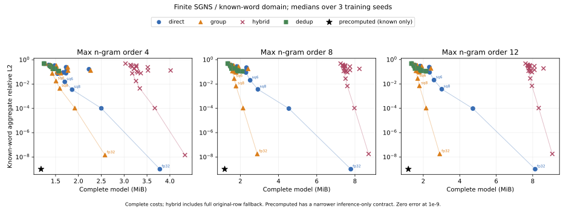
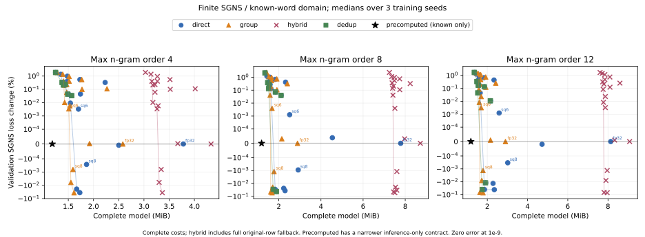
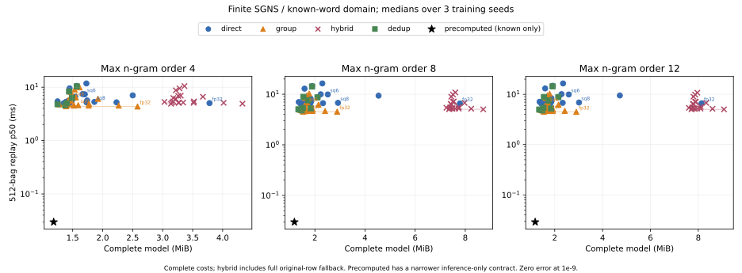
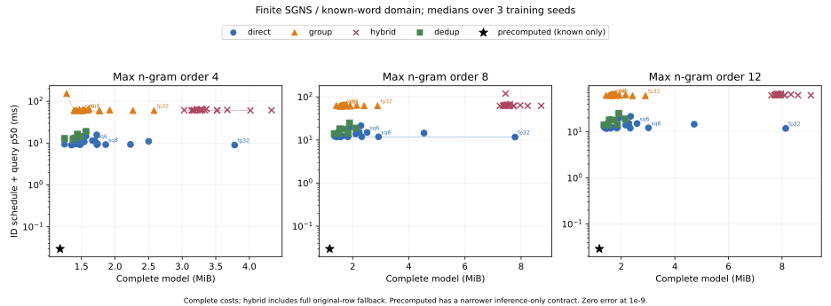

# Incidence compaction versus FAISS row codecs

Completed 2026-11-01. Nine cached, actually trained CPU SGNS checkpoints,
19 codec configurations and three query contracts produce **513 base
candidates**. Another **171 encoded-byte dedup audits** yield 64 smaller
candidates and 107 `flat-preferred` results: **577 scored variants**, no failed
final candidates. These are finite TinyShakespeare word-embedding results, not
Engram training, semantic quality, perplexity or production LLM evidence.

The supported conclusion is that **incidence compaction complements mature
quantization within a certified aggregate domain**. It does not dominate FAISS
across arbitrary queries, equal reconstruction accuracy and all serving costs.
Original FP32 row bytes change under group-mean projection and quantization.
The engine's ordinary byte-preserving storage contract is separate.

## Fixed-quality-budget result

Choose the smallest complete model on validation, with SGNS loss increases of
0.01%, 0.1% or 0.5%, context-discrimination decline at most 0.5 percentage point,
and known-word aggregate global relative L2 at most 5%. The direct family
includes beneficial encoded-byte dedup controls. Test scores do not select
models. Complete model sizes include FP32 word/output rows, the identical
word/n-gram registry, codes, codebooks/transforms, metadata, group maps and any
full hybrid fallback; fixed-trace plans are reported separately.

At the **0.1% loss budget**, all three seeds select SQ6 in both direct and
certified-group families. The figures below are medians over three seeds:

| Maximum order | Original n-gram rows | Incidence groups | Direct complete bytes | Certified-group complete bytes | Extra complete saving | Direct aggregate relative L2 | Group aggregate relative L2 |
| --- | ---: | ---: | ---: | ---: | ---: | ---: | ---: |
| 4 | 5,244 | 2,702 | 1,784,409 | 1,583,374 | 11.27% | 1.53–1.56% | 1.79–1.82% |
| 8 | 13,286 | 3,046 | 2,637,024 | 1,761,314 | 33.21% | 2.02–2.09% | 2.74–2.81% |
| 12 | 13,988 | 3,046 | 2,713,904 | 1,776,419 | 34.54% | 2.07–2.13% | 2.83–2.87% |

Higher maximum order exposes more removable incidence redundancy on this
corpus; order 8 to 12 largely saturates the group count. This is not a universal
monotonic law. Grouped SQ6 has higher aggregate error than direct SQ6, while
both satisfy the same declared bound. Capacity within a common quality budget
is distinct from equal-error dominance.

The 0.5% loss budget selects the same candidates because aggregate fidelity is
the binding constraint. At 0.01%, order-8 seed-7 selects group SQ8 instead;
median savings remain 11.27%, 33.21% and 34.54%. All **81 family/budget test
point estimates** pass their loss/discrimination gates. However, at the strict
0.01% loss budget, **6 of 27 family selections** have paired-bootstrap upper
bounds above the loss limit; hybrid duplicates the corresponding group quality
on known bags. This is not statistical certification of 0.01% noninferiority.
The intervals use paired 128-token blocks in one text, not independent corpora.

The rate and larger-cluster grids were extended after first-phase test summaries
became available. This combined comparison is **exploratory**, despite fitting
only on training rows and selecting only on validation. It needs replication
on new corpora before a general quality claim.

[Raw merged report](merged-report.json.gz), [analysis with paired intervals](analysis.json),
[derived numerical summary](results-summary.json), [protocol](../faiss_cotraining_protocol.md).

## Stronger controls and unfavorable results

- **Full-domain hybrid loses the capacity comparison.** It stores every original
  nonsingleton FP32 row for rejected queries, rather than only observed fallback
  rows. At the 0.1% budget, median sizes are 3,417,998 / 7,874,210 / 8,249,251
  bytes for orders 4/8/12, exceeding direct SQ6. Certified groups accept just
  97/512 nonempty OOV bags at order 4 and 54/512 at orders 8/12. Their known-word
  advantage must not be advertised as unrestricted OOV memory compression.
- **Known-word precomputation wins serving-only size and speed.** Retaining the
  original complete aggregates, outputs and word-only registry costs 1,240,108
  bytes; gathering 512 known vectors takes about 0.029 ms with zero aggregate
  error. This supports known-word inference, without arbitrary n-gram/OOV
  queries or the demonstrated shared-training parameterization.
- **Encoded-byte dedup is a real competing control.** Unique actual direct
  FAISS codes plus a narrow original-to-code map support every original ID with
  the same codec approximation. All original-ID reconstructions are checked.
  It helps 64/171 candidates, mostly PQ/OPQ and some larger clustering settings;
  107 map/codebook-inclusive bundles prefer flat storage. No dedup candidate
  wins the declared fixed-budget selection. OPQ decode batching has a separately
  audited floating-point tolerance; codec-byte equality is not FP32 losslessness.
- **Full-vector clustering is not excluded at a weak rate.** We test
  256/512/1,024/2,048 centers. Even at 2,048, direct aggregate relative L2 is
  16.63% / 22.39% / 24.11%; grouped is 13.20% / 17.58% / 18.84%. Small SGNS loss
  changes alone would misleadingly accept these reconstructions; the 5% gate
  excludes them. This does not cover every clustering algorithm or tuning budget.
- **Narrower group maps reduce disk bytes, not measured query RAM.** Verified
  uint16 certificates cost 11,532 / 27,616 / 29,020 bytes versus 42,996 / 107,332 /
  112,948 in the original format. This is a separate storage ablation; queries
  use the original certificate and runtime maps remain int64. The savings are
  not added to the main table.

## Query cost and implemented optimization

FAISS is used as a standalone **original-ID row codec**, not as an ANN search
baseline: mmap selected codes, decode only selected rows, aggregate the same
bags. Serialized indexes have `ntotal=0`; row codes are counted separately.
Every family already collapses repeated IDs with their multiplicities.

| Maximum order | Direct SQ6, 512-bag replay p50 | Group SQ6 replay p50 | Direct schedule + query p50 | Group schedule + query p50 |
| --- | ---: | ---: | ---: | ---: |
| 4 | 7.36 ms | 6.33 ms | 11.31 ms | 60.17 ms |
| 8 | 9.90 ms | 6.58 ms | 14.97 ms | 63.48 ms |
| 12 | 9.92 ms | 6.56 ms | 15.15 ms | 63.38 ms |

These frozen FAISS runs compile certificates one bag at a time. Their grouped
replay is faster, but **immediate compilation plus query is slower**. Results
use fresh processes, one query thread, warm pages, two warmups and 15 samples
on a shared CPU. Cross-phase timing is descriptive; no exclusive-service or
disk-cold speed claim follows. Query process RSS includes Torch/FAISS runtime;
small artifact savings do not demonstrate a corresponding process-RSS gain.

The implementation now adds `BagPartition.certifies_many`, using batched integer
count comparisons, and uses it in `CertifiedBagPlan`. A separate interleaved
old/new benchmark on the same nine checkpoints verifies every native plan
array byte-for-byte and identical acceptance of 1,024 known/OOV bags:

| Maximum order | Scalar to batch certificate p50 | Paired speedup | Old to batch native-plan p50 | Paired speedup |
| --- | ---: | ---: | ---: | ---: |
| 4 | 79.66 → 10.23 ms | 7.79× | 60.05 → 17.67 ms | 3.39× |
| 8 | 79.73 → 10.84 ms | 7.34× | 62.07 → 19.75 ms | 3.14× |
| 12 | 81.73 → 11.13 ms | 7.34× | 62.59 → 20.95 ms | 3.13× |

This is an actual native-plan construction optimization. It does not retime the
FAISS schedule/reducer above, and the local gains cannot be added together to
infer full serving latency. [Source-pinned batch evidence](batch-certificates-final.json),
[public API](../cotraining_groups.md).

## Measured frontiers

Each point is a three-seed median, with complete costs and the stronger
precomputed control. Curves connect each family's observed capacity frontier;
they do not prove unmeasured configurations are dominated. Exact zero error is
displayed at 1e-9. Model quality, reconstruction and query cost remain separate.

## Provenance, reproduction and failures

Cached TinyShakespeare references: 128 dimensions, 1,200 training words,
maximum orders 4/8/12, seeds 3/7/11, 2,000 × 256 sampled SGNS training pairs.
These are the earlier held-out-compression checkpoints, not the new
64-dimensional training-dynamics study. The original model uses contiguous
80/10/10 token splits. Fitting samples at most 16,384 original training n-gram
IDs without replacement (seed 42); grouped fitting uses the same sampled IDs
and preserves occupancy weighting. Training convergence is not asserted.
Evaluation uses 8,192 sampled pairs per split with five fixed negatives,
excludes OOV centers/targets and retains their positional gaps. Test token
coverage is about 76.47%. Complete checkpoint/corpus, evaluation, fit-ID,
partition and trace hashes are recorded and matched across phases.

TinyShakespeare is the cached text from
[Karpathy's char-rnn data](https://github.com/karpathy/char-rnn/tree/master/data/tinyshakespeare).
Shakespeare's source works are public domain; no independent redistribution
license is asserted for upstream preprocessing. No text, vocabulary or model
weights are redistributed by this report. Reproduction needs the original
cached checkpoints matching the published hashes; it does not silently generate
new checkpoints or invent vectors. [Original training/evaluation source](../heldout_compression_evidence_20261024/README.md).

CPU: AMD EPYC 7742, Linux x86-64 (5.4 kernel, glibc 2.35), Python 3.11.15,
PyTorch 2.11.0+cu130, NumPy 2.2.6, FAISS CPU 1.15.0 (AVX2). Queries use one
thread. Base fits use one thread; rate/cluster extensions fit with four.
All runs set `CUDA_VISIBLE_DEVICES=''`; no GPU process is inspected or modified.
No monetary/energy metering, million-row FAISS sweep, bounded-RAM build or
independent workload replication is included.

| Phase | Frozen source | Candidates | Fitting threads |
| --- | --- | ---: | ---: |
| FP32, FP16, SQ8, cluster256, PQ8×4/8×8/16×8, OPQ8×8, RQ2×8 | `a068a714d6caf9498ac75a798ff034b8a6a9a815` | 243 | 1 |
| SQ4/6, PQ32×8/64×8, OPQ32×8/64×8, RQ4×8 | `64ebc74211d76f37db46dbb0a9b20973140ef4b8` | 189 | 4 |
| cluster512/1024/2048 | `3147a21d1778b912d84a71c8ca777865d1045cb1` | 81 | 4 |
| Base encoded-byte dedup | `cdd6c682d14bcd6a498a86829dbbf1c695651182` | 81 audits | No refitting |
| Rate/cluster encoded-byte dedup and merged analysis | `e6d287014c2f5c2914ab255645cbfd48f05ed9a5` | 90 audits | No refitting |
| Batched native-plan experiment | `106ee3a5d33764becd2a14b1942fb303c384755a` | 9 paired runs | 1 |

[Phase provenance](phase-provenance.json) preserves exact recorded commands,
settings, versions and source-file hashes. [Commands](commands.md) explain
source-pinned versus current-checkout reproduction. [reproduce.sh](reproduce.sh)
runs the present code as a **new measurement**. The numeric analysis remains
from `e6d2870`; subsequent figure edits only move legends/remove crowded labels.
[Manifest](manifest.json) records raw-data, analysis and renderer hashes.

Final full Linux tests at `e6d2870`: **165 run, 17 skipped, successful**;
[full output](latest-full-tests.txt). Relevant earlier failed attempts are retained:

- [Initial OPQ strict-equality assertion](targeted-tests.txt): different decode
  batch shapes differ by about 2.38e-7; corrected to explicit floating-point
  tolerance rather than claiming byte-identical FP32 decoding.
- [Superseded owner-lifetime phase](superseded.txt), [partial log](run.log.gz):
  OPQ borrowed training-PQ ownership was fixed; the old phase is excluded.
- [Superseded one-thread slow rate fits](superseded-rate-grid.txt),
  [partial log](rate-grid.log.gz): own CPU experiment stopped; restarted with
  explicit four-thread fitting, retaining one-thread queries.

Final [base log](final-run.log.gz), [rate log](rate4-run.log.gz) and
[cluster log](cluster-run.log.gz) preserve warnings and measured outputs.
Raw checkpoints, internal hostnames and credentials are excluded.
