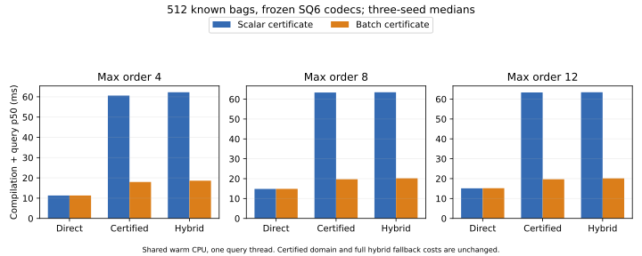

# Compilation plus FAISS bag-query retiming

Completed 2026-11-02. The FAISS row-codec path now uses one batch certificate
instead of scalar certification per bag, and constructs the full fallback rank
map only if a hybrid query actually needs fallback. On the nine frozen trained
SGNS references, **known-word compilation plus query is 3.2–3.4× faster** for
certified groups, with identical output bytes and model cost. It remains slower
than direct SQ6 compilation plus query. This is a measured query-path
improvement, not production LLM latency or new compression-quality evidence.

## Actual total query-path improvement

Freeze the 0.1% loss-budget validation selections from the
[FAISS comparison](../faiss_cotraining_evidence_20261101/README.md): direct,
certified group and full-domain hybrid, each SQ6, for orders 4/8/12 and seeds
3/7/11. All 27 candidates reuse their existing codebooks and row codes. No
refitting, vector construction, new selection or test-score tuning occurs.

These are medians across three trained seeds, each querying the same 512
known-word bags. Speedups are medians of within-process ratios:

| Maximum order | Direct old → new compilation + query | Certified old → new | Certified paired speedup | Hybrid old → new | Hybrid paired speedup |
| --- | ---: | ---: | ---: | ---: | ---: |
| 4 | 11.32 → 11.32 ms | 60.59 → 17.97 ms | 3.37× | 62.23 → 18.61 ms | 3.35× |
| 8 | 14.85 → 14.88 ms | 63.34 → 19.69 ms | 3.20× | 63.45 → 20.18 ms | 3.14× |
| 12 | 15.13 → 15.17 ms | 63.32 → 19.69 ms | 3.21× | 63.42 → 20.12 ms | 3.13× |

All known bags are accepted by all three contracts. Direct is the unchanged
control; its old/new measurements are effectively stable on these traces.
The improvement includes fresh schedule compilation followed by selected-code
decoding and bag aggregation, rather than only timing the certificate.



Certified compilation alone drops from 54.56 / 56.72 / 57.18 ms to
11.58 / 13.14 / 13.11 ms. This is still the main remaining cost; the new path
does not share its original-row counting with construction of weighted group
schedules. No additional gain from removing that duplication is asserted.
The previous complete capacity savings remain **11.27% / 33.21% / 34.54%**
relative to the smallest qualifying direct codec in that grid. Neither codes,
model bytes, precompiled schedules nor original-reference fidelity changed.

## OOV and full-domain costs remain explicit

The same 512 nonempty OOV query types are used per order. Certified-only
timing includes rejected bags and supports only the reported accepted subset:

| Maximum order | Certified accepted OOV | Certified old → new compilation + query | Full hybrid accepted OOV | Full hybrid old → new | Hybrid paired speedup | New direct OOV |
| --- | ---: | ---: | ---: | ---: | ---: | ---: |
| 4 | 97/512 | 43.03 → 8.48 ms | 512/512 | 60.24 → 20.59 ms | 2.93× | 11.85 ms |
| 8 | 54/512 | 40.77 → 7.53 ms | 512/512 | 59.78 → 21.78 ms | 2.75× | 12.78 ms |
| 12 | 54/512 | 41.24 → 7.53 ms | 512/512 | 59.79 → 21.69 ms | 2.76× | 12.83 ms |

The full hybrid gain is measured while accepting every query; it does not
depend on counting rejection as useful output. It still trails direct SQ6
and retains the full original nonsingleton FP32 fallback cost. Restricted
certified timings cannot establish a full-domain speed advantage.
Known-word precomputation remains the earlier stronger, narrower serving
baseline (1,240,108 bytes, about 0.029 ms per 512-word gather); it is not retimed
here and does not support arbitrary n-gram/OOV lookup or training.

## Byte equality and source isolation

Before timing each candidate, verify every saved known/OOV schedule array against
scalar-reference and new batch compilation, including rejection flags/counts.
Also check all 1,200 registered-word aggregate outputs byte-for-byte, or 32,400
candidate/word checks across 27 candidates. Old/new measured outputs are
byte-identical; every original-reference fidelity summary and trace hash matches
the frozen report exactly. The reducer function source is unchanged, and codec
files, original jobs, reference functions and source files receive hashes.

This implementation change adds no distortion. It does not make SQ6 or
group-mean projection byte-preserving relative to original FP32 rows. The
certified-domain and optimizer assumptions remain intact. All 27 workers
completed successfully. [Raw samples and metadata](report.json),
[three-seed summary](summary.json), [run log](run.log),
[pre-run protocol and source clarification](../faiss_schedule_protocol_20261102.md).

## Environment and reproduction

Benchmark source: `c9215821ce3704a3dd3568a06b8c582fedf96c16`. Scalar reference:
`f9994ca2dbe15f54826123ee2b0e3f684da6e5ff`; its schedule matches the selected
SQ6 rate phase at `64ebc742`. The reference reducer is verified identical to
the new source. The uncompressed frozen report SHA256 is recorded and checked
against the published 2026-11-01 artifact.

AMD EPYC 7742 shared CPU, Linux x86-64 / glibc 2.35, Python 3.11.15, NumPy 2.2.6,
FAISS CPU 1.15.0; the environment contains PyTorch 2.11.0+cu130, but retiming
workers do not import Torch or train models. Each candidate uses a fresh
process, one FAISS/BLAS thread, two warmups and 15 repetitions, with five modes
interleaved in fixed seed-42 order. No GPU process is inspected or modified;
`CUDA_VISIBLE_DEVICES=''` throughout.

Paired interleaving reduces temporal drift on the shared warm CPU but does not
establish exclusive-service or independent-workload performance. New worker RSS
includes output checks and omits the previous Torch import; no query-RAM gain
is claimed from comparing those RSS values. No monetary/energy metering, new
corpus, cold-disk run or LLM quality measurement is included.

Extract the reference with
`git show f9994ca:tools/benchmark_faiss_cotraining.py > "$OLD_MODULE"`, then run
the protocol command at source `c9215821`, with the original artifact roots.
The exact expanded command, package versions, CPU description and file hashes
are in `report.json`. Reproduction requires cached codec/common artifacts,
without new training or corpus downloads. Public metrics can be summarized and
plotted without weights:

```bash
python -m tools.analyze_faiss_schedule \
  --report docs/faiss_schedule_evidence_20261102/report.json \
  --output-dir artifacts/faiss-schedule-redrawn --plots
```

Full Linux suite at the benchmark source: **166 tests run, 17 skipped,
successful**; [full log](full-tests.txt). All 21 relevant FAISS/certification
tests pass with no skips; [targeted log](targeted-tests.txt). New regression
coverage prevents member counts being borrowed from another query and checks
unequal multiplicity, empty batches and hybrid fallback.
[Manifest](manifest.json) records published file and analyzer hashes.
