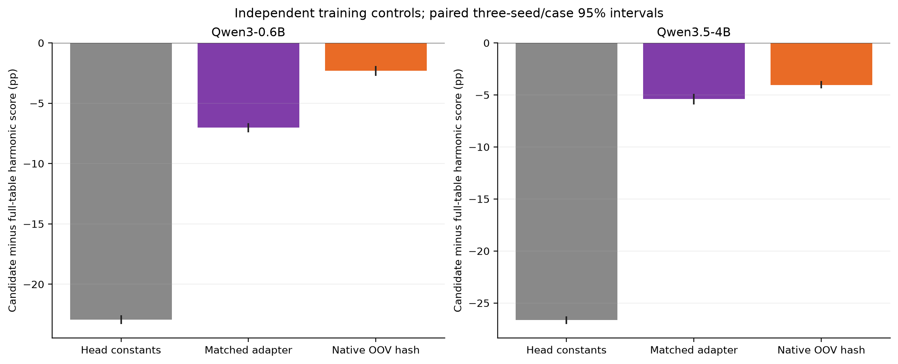
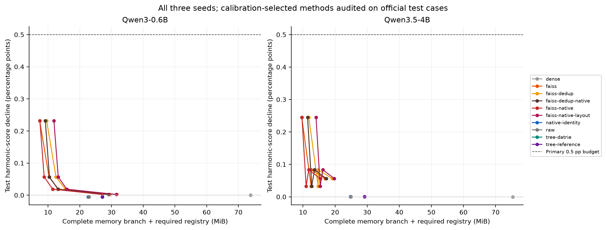
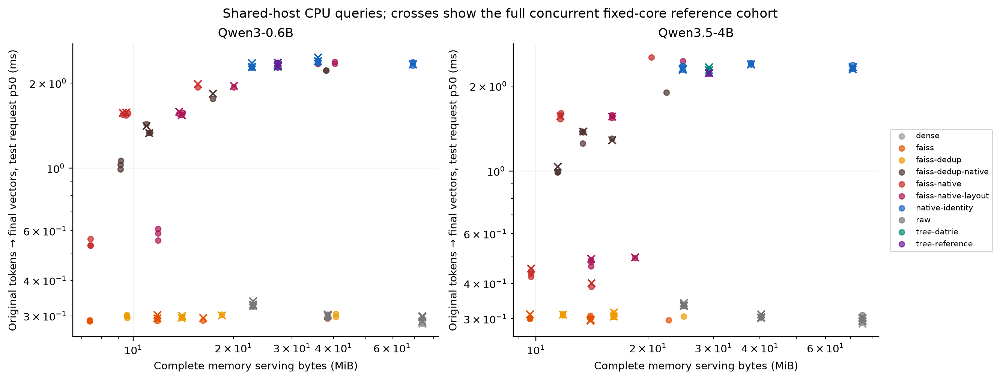

# Complete trained-memory application study

The full registered comparison is complete. A learned full-key memory branch
outperforms independently trained head constants, parameter-matched adapters
and the matched hash branch on these frozen Qwen tasks. NGramStore additionally
packs existing FAISS row codes while preserving their code bytes, codebooks,
original IDs and decoded values. Scalar-code storage benefits; some PQ tables
expand, and native CPU queries remain slower than direct codes.

This is finite evidence from enwik8 SGNS and MultiCounterFact memory branches
on frozen Qwen3-0.6B and Qwen3.5-4B backbones. It is not an Engram pretraining
result or a claim that every workload requires full-key memory.

The subsequent [controlled deployment experiments](../controlled_deployment_results_20261112.md)
are also complete: 864 Qwen GPU reports, full AG News/DBpedia tests, 360 public
application GPU pairs and 6,084 CPU reports. Capacity savings and measured query
slowdowns are reported together; the larger classifier grids do not establish
universal full-key superiority over hashing.

## Complete coverage

| Stage | Completed coverage |
| --- | ---: |
| Trained SGNS checkpoints | 108: two derivative conventions, orders 4/8/12, three seeds, two initialization scales, three durations |
| SGNS codec candidates | 28,188: all 261 per checkpoint |
| Fresh SGNS test/confirmation audits | 56,376 |
| Trained Qwen checkpoints / candidates | 6 / 1,566 |
| Independently trained constants/adapters | 12 |
| SGNS / Qwen main CPU requests | 12,818 / 220 |
| Canonical Qwen GPU requests | 476 |
| Spare / second-host / extra original-host GPU cohorts | 82 / 164 / 82 |
| SGNS / Qwen fixed-core reference requests | 1,728 / 84 |
| Runtime source versions archived | 21 |

The [protocol](protocol.json), [completed study record](study-summary.json),
[publication inventory](publication.json) and [raw capsule manifest](raw-manifest.json)
record coverage and source hashes. Validation/calibration freezes candidates;
test and confirmation never reselect. The additional 57 candidates per model
compose the earlier FAISS row codes with native storage.

## Full-memory utility against independent controls

The table reports the full-key branch's harmonic-score advantage, in percentage
points. Intervals resample all three seed clusters and the same official test
case IDs within each pair, with 2,000 replicates. The adapter has matched
trainable parameter count; backbones, inputs, exposures and optimizer steps
are controlled. Hash uses its native open-vocabulary query contract.

| Independent comparator | Qwen3-0.6B advantage, paired 95% interval | Qwen3.5-4B advantage, paired 95% interval |
| --- | ---: | ---: |
| Head constants | 22.94 [22.57, 23.29] | 26.63 [26.27, 27.01] |
| Parameter-matched adapter | 7.02 [6.64, 7.42] | 5.39 [4.90, 5.92] |
| Matched hash memory | 2.29 [1.92, 2.74] | 4.05 [3.65, 4.36] |

These controls support memory utility in this task. The constants are much
smaller, while the matched adapters and hash branches have separate capacity
accounting. The metric averages rewrite, paraphrase and neighborhood behavior;
it is not general-language-model accuracy. Pointwise intervals do not imply
independent-task replication or simultaneous guarantees across all choices.



## Lossless storage composed with lossy FAISS codes

At the predeclared 0.5 pp calibration budget, both families select the same
decoded representation in each paired row below. Native storage preserves that
already-quantized representation; it does not make FAISS quantization lossless
relative to source FP32. Bytes include the complete memory branch and required
registry, rather than only compressed row payloads.

| Model / seed | Selected code | Direct FAISS MiB | FAISS + native MiB | Extra file saving | All four test metrics within 0.5 pp |
| --- | --- | ---: | ---: | ---: | --- |
| 0.6B / 3 | SQ4 | 11.784 | 9.518 | 19.23% | Yes |
| 0.6B / 7 | SQ6 | 16.216 | 15.637 | 3.57% | Yes |
| 0.6B / 11 | SQ4 | 11.784 | 9.296 | 21.11% | Yes |
| 4B / 3 | SQ4 | 13.987 | 11.620 | 16.92% | Yes |
| 4B / 7 | PQ-8x8 | 9.636 | 9.690 | -0.57% | No |
| 4B / 11 | PQ-16x8 | 14.018 | 14.085 | -0.48% | Yes |

The 4B seed-7 choice fails the held-out budget despite qualifying on calibration;
the same failure affects the direct and native representation. Native packing
adds overhead on both selected PQ tables. The archived full grid retains all
losing choices and alternate native layouts.

The standalone DATrie/tree-reference joint planners do not beat the complete
FAISS frontier here. Longer training increases some structural compressibility,
but the 18 validation-selected SGNS training points use 2k or 8k steps, rather
than the 32k mechanism endpoints. Compressibility alone is not generalization.



## Measured query and decode costs

Matched seed-3 SQ4 controls illustrate the capacity/query tradeoff. CPU p50
covers original tokens through final vectors, with zero application row cache
and a warm OS cache. GPU p50 covers the registered 16-step batch-1 cached decode.

| Model | Direct SQ4 CPU p50 ms | Native SQ4 CPU p50 ms | Direct SQ4 GPU decode p50 ms | Native SQ4 GPU decode p50 ms |
| --- | ---: | ---: | ---: | ---: |
| Qwen3-0.6B | 0.295 | 1.540 | 68.756 | 70.262 |
| Qwen3.5-4B | 0.307 | 1.528 | 84.116 | 83.811 |

Native CPU decoding is slower in these matched samples. The small GPU differences
are observations on shared machines, not a normalized speedup or production
throughput guarantee. All cache, batch, model and method controls remain in the
raw archive. CPU reference lanes share memory bandwidth; legacy `serial-reference`
paths identify the reference request set, not host-exclusive execution.

Every method in a GPU cohort uses the same fixed prompt-to-device/core assignment.
Prompt replicas have separate caches and device allocations. Aggregate throughput
is recomputed from request samples and never summed across GPUs. The official
distinct-request source/native checks retain byte-identical cached logits and
generated sequences. Runtime versions and hardware observations are in each
archived report. Earlier interrupted measurements and dispatcher race failures
remain recovery diagnostics.



## Download and independently verify

All numeric evidence and runtime snapshots are in the seven assets of the
[evidence release](https://github.com/initial-d/ngram-store/releases/tag/memory-application-evidence-20261110).
Their SHA-256 values, exact members and byte counts are in `raw-manifest.json`.
The archive excludes lexical keys, token sequences and model weights. Arithmetic
verification checks the published reports; model reruns require the separately
identified public inputs and trained fixtures.

From a checkout containing this study:

```bash
python -m tools.fetch_memory_application \
  --manifest docs/memory_application_evidence_20261110/raw-manifest.json \
  --output artifacts/memory-application-evidence
CUDA_VISIBLE_DEVICES='' python -S -m tools.verify_memory_application \
  --root artifacts/memory-application-evidence --jobs 1
```

Linux/macOS can use `--jobs 16` for independent SGNS verification. The verifier
uses only the standard library and checks all hashes, frozen choices, quality
arithmetic, intervals, request/repeat coverage, byte identities and serving costs.
It fails on missing or changed evidence. The exact training, quality and serving
commands, Python/PyTorch versions, OS and CPU/GPU observations are archived.
Shared institutional machines were used; energy and monetary costs were not
measured.

Machine-readable summaries are in [analysis](analysis/); all 108 points,
including validation-unselected and unfavorable endpoints, remain accessible.
The [training-duration figure](figures/training-duration-initialization.png)
keeps the distinction between compressibility and source quality visible.
