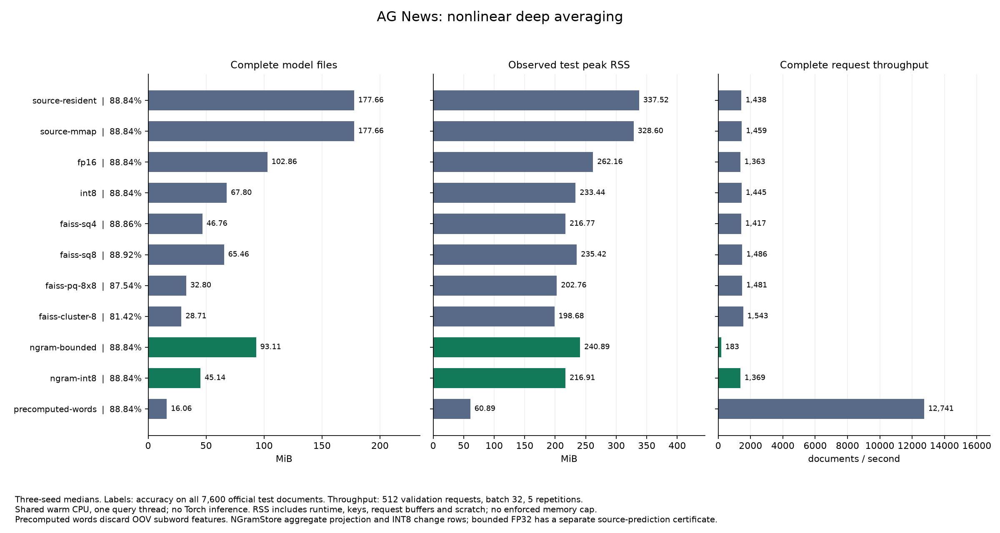
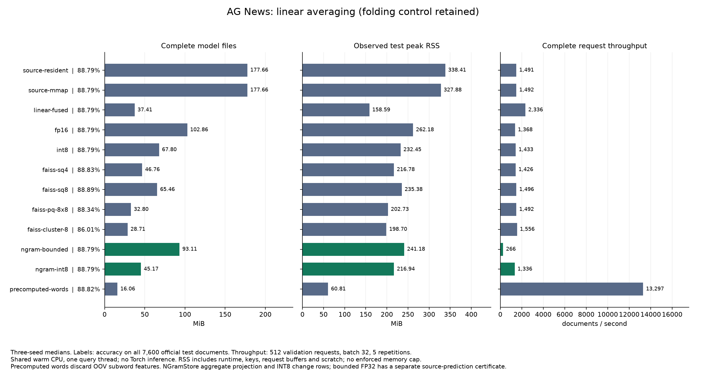

# Real AG News application: complete CPU serving evidence

Completed 2026-11-05. The primary model is a supervised nonlinear deep-averaging classifier: word/subword means, document mean, ReLU, four-class head. It uses the complete official 120,000-document training split (108,000 updates / 12,000 validation) and all 7,600 official test documents, seeds 3/7/11. This is a real public-data application, not a state-of-the-art news classifier or an LLM accuracy claim.

**NGramStore INT8 reduces complete model files 177.66 → 45.14 MiB (74.59% saving), and saves 33.42% beyond ordinary rowwise INT8.** Both INT8 paths have identical predictions on all 22,800 three-seed test requests. Test accuracy median is 88.8421%; the median paired change versus FP32 is -0.0132 percentage points. These are approximate aggregate/quantization modes; original vector-row bytes change.

The bounded FP32 path uses 93.11 MiB and agrees with the source on every test prediction. It certifies 22,794/22,800 predictions (99.9737%), with zero certified disagreements. Certification refers to the declared FP32 source model in real arithmetic, not ground-truth correctness. The uncertified predictions remain in the evaluated workload.

**The performance boundary is retained.** At batch 32, NGramStore INT8 reaches 1,369 validation documents/s versus 1,445 for row INT8 and 1,417 for FAISS SQ4. SQ4 is slightly larger and changes more source predictions, but has slightly better test accuracy here. Precomputed words are smaller and much faster, and win the fixed eligible budgets; they discard OOV subword features. Only 42 test documents meet the frozen >=10% OOV threshold, too few to establish an OOV quality advantage.

## Primary nonlinear model

All entries are three-seed medians. Accuracy, F1, cross-entropy and RSS use the full official test; throughput uses 512 fixed validation requests, batch 32, one warmup and five repetitions. Complete logical bundle files count tables, keys, word CSR, heads, maps, scales/codebooks, bounds and metadata. Runtime/native-library costs are separate; observed process RSS includes them. No compact source fallback or hidden word-vector cache is present. Native decoded row cache is 4 MiB.

| Backend | Model MiB | Test peak RSS MiB | Test accuracy % | Macro-F1 % | Cross-entropy | Validation docs/s |
| --- | ---: | ---: | ---: | ---: | ---: | ---: |
| source-resident | 177.66 | 337.52 | 88.8421 | 88.8094 | 0.342822 | 1,438 |
| source-mmap | 177.66 | 328.60 | 88.8421 | 88.8094 | 0.342822 | 1,459 |
| fp16 | 102.86 | 262.16 | 88.8421 | 88.8094 | 0.342822 | 1,363 |
| int8 | 67.80 | 233.44 | 88.8421 | 88.8089 | 0.342824 | 1,445 |
| faiss-sq4 | 46.76 | 216.77 | 88.8553 | 88.8224 | 0.344019 | 1,417 |
| faiss-sq8 | 65.46 | 235.42 | 88.9211 | 88.8921 | 0.342654 | 1,486 |
| faiss-pq-8x8 | 32.80 | 202.76 | 87.5395 | 87.5055 | 0.405992 | 1,481 |
| faiss-cluster-8 | 28.71 | 198.68 | 81.4211 | 81.0849 | 0.532045 | 1,543 |
| ngram-bounded | 93.11 | 240.89 | 88.8421 | 88.8094 | 0.342822 | 183 |
| ngram-int8 | 45.14 | 216.91 | 88.8421 | 88.8089 | 0.342824 | 1,369 |
| precomputed-words | 16.06 | 60.89 | 88.8421 | 88.8080 | 0.342870 | 12,741 |



The first source row is resident FP32; the second is mmap FP32. Scalar/PQ/clustering entries are actual-row-trained FAISS reconstruction codecs, not approximate-nearest-neighbor search benchmarks. SQ4/SQ8/PQ8x8/256-centroid full-vector clustering were fixed before test. Codebooks use a seed-42 sample of 32,768 trained source rows. Poor PQ/clustering seeds are retained. Direct codecs do not compute residual certificates in this implementation; this does not establish that certificates cannot be added to them.

## Linear graph and budget limits

The initial linear graph is retained with its stronger offline four-class head-folding control. Folding reduces stored row width from 64 to 4 while retaining OOV n-grams, up to FP32 materialization rounding; it is inapplicable through document ReLU. Precomputed words remain applicable to both graphs and can win. Neither control is hidden.

| Linear backend | Model MiB | Test accuracy % | Validation docs/s |
| --- | ---: | ---: | ---: |
| source-resident | 177.66 | 88.7895 | 1,491 |
| source-mmap | 177.66 | 88.7895 | 1,492 |
| linear-fused | 37.41 | 88.7895 | 2,336 |
| fp16 | 102.86 | 88.7895 | 1,368 |
| int8 | 67.80 | 88.7895 | 1,433 |
| faiss-sq4 | 46.76 | 88.8289 | 1,426 |
| faiss-sq8 | 65.46 | 88.8947 | 1,496 |
| faiss-pq-8x8 | 32.80 | 88.3421 | 1,492 |
| faiss-cluster-8 | 28.71 | 86.0132 | 1,556 |
| ngram-bounded | 93.11 | 88.7895 | 266 |
| ngram-int8 | 45.17 | 88.7895 | 1,336 |
| precomputed-words | 16.06 | 88.8158 | 13,297 |



Artifact ceilings are 16/32/64/128/256 MiB; current-exec peak-RSS ceilings are 128/192/256/384/512 MiB. Validation gates allow <=0.5 percentage-point accuracy loss and <=2% CE increase versus each source. The fastest eligible backend is frozen before its test sweep. No eligible artifact at 16 MiB is a recorded result, not an OOM claim. Test budget/quality audits are in `summary.json`; none of these thresholds is an OS-enforced RAM limit.

## Provenance, input and installation checks

Shared CPU host: AMD EPYC 7742 64-Core Processor; Linux-5.4.0-42-generic-x86_64-with-glibc2.35. Python 3.11.15, NumPy 2.2.6, training PyTorch 2.11.0, FAISS 1.15.0. Training uses four CPU threads/one interop thread; inference uses one query thread with no Torch. No GPU inspection/use or GPU process stops occurred. No exclusive, cold-cache, energy or monetary claim is made.

The table has 612,759 × 64 FP32 source rows: 41,892 protected whole-word rows and 570,867 exact character-n-gram keys, orders 2..8, from all 62,035 training token types. Singleton word types also participate in the incidence domain. Identical full incidence/multiplicity groups preserve complete registered aggregates in real arithmetic; arbitrary partial/OOV bags require source-relative error bounds. This application measures incidence compaction and native packing, not a separate DATrie lookup-speed benefit.

Input audit: train/validation/test retained-token, truncation, OOV, missing-ngram and empty-bag counts are in `preprocessing-audit.json.gz`. Test: 288,389 retained tokens, 1,758 unknown-token occurrences, 5 truncated documents, 14,958 missing OOV n-gram occurrences, 0 empty OOV bags.

The initial Linux `ru_maxrss` measurements inherited the controller's pre-exec high-water mark. A controlled 256 MiB parent reproduces this while child `VmHWM` stays near 10 MiB. The corrected full sweeps use current-exec `/proc/self/status` `VmHWM`; lifetime `ru_maxrss` remains diagnostic only. Original complete/partial runs, the intentional stop of this task's own CPU worker, original environment and reproduction are retained in `superseded-rss/`, `rss-diagnostic.json` and logs. No graph, data, training, codec, quality gate or budget changed.

Other failures are preserved: the initial dataset notice request used `README.md` (404), followed by successful `readme.txt`; initial export rejected NumPy integer representatives; the first remote export used the wrong library keyword and stopped before evaluation. Final targeted tests pass on Linux (8 tests), local full tests pass (205, 101 optional/platform skips), and actual AG News seed-3 bundles pass API/CLI inference from an independently installed wheel outside the checkout without importing Torch. Authored-text wheel predictions are functional checks, not extra accuracy evidence.

Raw reports are compact JSON gzip with all per-request labels/predictions/losses/flags and raw latency samples; `manifest.json` binds them and their original formatted-report hashes. Export inventories bind each standalone file's logical bytes and SHA; source weights/head and registry hashes tie training to every backend. The validation-selection file is checked against the pre-test worker observations. News text, training arrays and model/sidecar weights are not redistributed; the pinned dataset research-use notice is retained.

```bash
python -S docs/news_classifier_evidence_20261105/verify.py
```

See [application commands](../news_classifier_app.md), [frozen initial protocol](../news_classifier_protocol_20261105.md), [nonlinear follow-up](../news_relu_protocol_20261105.md), [numeric summary](summary.json) and [exact task scripts](commands/). Measured serving code is commit `237cb86953a4a0061e1047b5a82d4c8d2d3d00cc`; the original failed RSS sweep used `84c21ea`. Linear training used `698efce`; nonlinear training used `84c21ea`. Later helper/docs commits do not relabel these timings as a new implementation.
