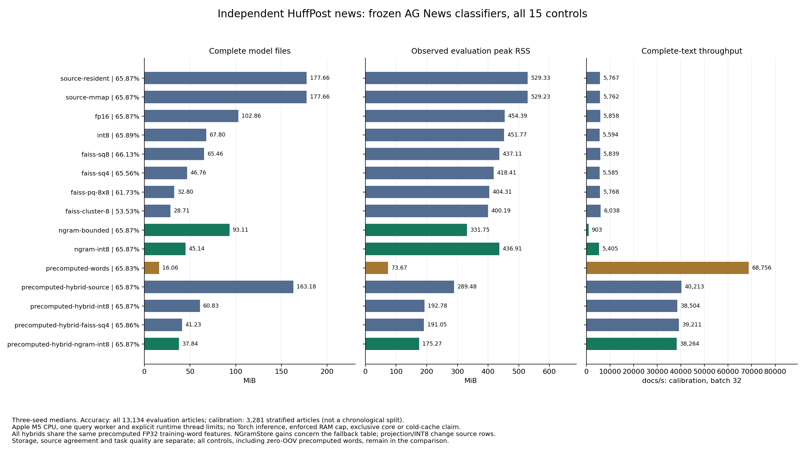
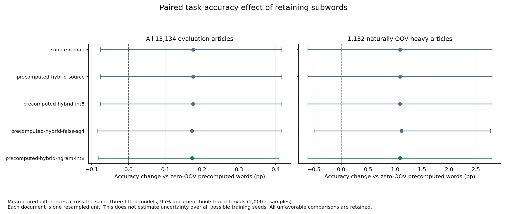

# Independent news: useful hybrids, but no necessary-backend result

**NGramStore's precomputed/subword INT8 hybrid uses 37.84 MiB of complete files,
versus 60.83 MiB for the ordinary INT8 hybrid (37.79% saving), with comparable
full-request throughput.** It retains an n-gram fallback for unknown words and
changes only 3 of 39,402 evaluated source predictions across three fitted models.
Projection and INT8 change original rows; this is not original-row losslessness.

**The stronger application-necessity claim did not pass.** Zero-OOV precomputed
words are 16.06 MiB, faster, and win every qualified fixed budget. Retaining
subwords improves mean paired accuracy by 0.1751 percentage points versus that
control, but its 95% document-bootstrap interval is [-0.0761, +0.4163] pp. On
1,132 naturally OOV-heavy articles, the point estimate is +1.0895 pp with
[-0.6184, +2.7974] pp: neither establishes a positive task-quality advantage.
The source classifier's 65.87% cross-source accuracy also limits application
readiness. Keep these limits with the storage numbers.

## Data, model and measurements

- Independent [HuffPost News Category Dataset mirror](https://huggingface.co/datasets/heegyu/news-category-dataset/tree/304a05a55bc6abc0446d8fae0d0771716b6a271a),
  attributed to Rishabh Misra's [original dataset](https://www.kaggle.com/datasets/rmisra/news-category-dataset).
  Mirror revision `304a05a55bc6abc0446d8fae0d0771716b6a271a` declares CC BY 4.0.
  SHA256 `2cfc51fa4a82a96ecbe251fa383737aa1dea2e0a517f61dece633fcc25a4a065`.
- 209,527 original rows; 16,472 literal WORLD NEWS/SPORTS/BUSINESS/TECH rows.
  Remove one unsupported empty input and 56 duplicates; no conflicting-category
  duplicates or tokenized AG News overlaps. Final 16,415 articles, dated
  2012–2022. Original taxonomies/style differ from AG News.
- 3,281 backend-calibration / **13,134 evaluation** articles, stratified by
  category and content SHA256. **Not a chronological holdout.** The rejected
  input-only time split had zero World News calibration rows; the amendment was
  committed before any external predictions. Its audit remains below.
- Evaluation has 1,132 >=10%-OOV articles and 5,433 unknown token types.
  10,123 / 362,539 tokens are OOV; 86,277 / 385,731 attempted unknown-word
  n-grams are absent from the frozen training registry. No artificial typos,
  type holdouts, injected names or target-data model training.
- Three **fresh local replications** of the original full AG News protocol,
  seeds 3/7/11, 108k update/12k validation documents, eight CPU epochs, epoch
  chosen only by AG News validation CE. These are separate checkpoints from
  the earlier remote run. Source training commit `0c1733e`, final measurement
  commit `c5f02bc`; complete SHA values/commands are retained in metadata.
- 612,759 x 64 source rows (41,892 independent whole words, 570,867 grams);
  mean word/document features -> ReLU -> four-class head. Every hybrid stores
  the same 62,035 precomputed FP32 training-word features and only the n-gram
  fallback suffix, without unused word-bag arrays. SQ4 reuses its original
  codebook and slices existing codes; NGramStore reuses training-incidence means.
- Apple M5, 32 GiB RAM, Python 3.12.14, NumPy 2.5.4, Torch 2.11.0 for source
  training, FAISS 1.15.1. Fresh **NumPy/C** inference workers, no Torch imports;
  native decoded cache 4 MiB. Final OMP/MKL/OPENBLAS/VECLIB limits are all 1.
  Shared warm CPU, no exclusive core, cold-cache or OS-enforced RAM budget.
- Full text requests, 512 fixed calibration requests, batches 1/32, one warmup,
  five repetitions. Full evaluation traversal throughput is reported separately.
  RSS includes runtime, keys, request text, mmap pages and scratch. File budgets
  and observed-RSS eligibility are distinct; neither is an enforced memory cap.

## All controls (three-seed medians)

| Backend | Complete MiB | Evaluation peak RSS MiB | Accuracy % | Macro-F1 % | Calibration batch32 docs/s |
| --- | ---: | ---: | ---: | ---: | ---: |
| source-resident | 177.66 | 529.33 | 65.8748 | 64.7822 | 5,767 |
| source-mmap | 177.66 | 529.23 | 65.8748 | 64.7822 | 5,762 |
| FP16 | 102.86 | 454.39 | 65.8748 | 64.7822 | 5,858 |
| ordinary INT8 | 67.80 | 451.77 | 65.8901 | 64.7923 | 5,594 |
| FAISS SQ8 | 65.46 | 437.11 | 66.1261 | 65.0785 | 5,839 |
| FAISS SQ4 | 46.76 | 418.41 | 65.5550 | 64.5405 | 5,585 |
| FAISS PQ8x8 | 32.80 | 404.31 | 61.7253 | 60.6308 | 5,768 |
| FAISS 256-centroid clustering | 28.71 | 400.19 | 53.5328 | 51.1306 | 6,038 |
| NGramStore bounded FP32 | 93.11 | 331.75 | 65.8672 | 64.7742 | 903 |
| NGramStore INT8 | 45.14 | 436.91 | 65.8748 | 64.7772 | 5,405 |
| Zero-OOV precomputed words | 16.06 | 73.67 | 65.8291 | 64.7150 | 68,756 |
| Precomputed + source FP32 | 163.18 | 289.48 | 65.8748 | 64.7822 | 40,213 |
| Precomputed + ordinary INT8 | 60.83 | 192.78 | 65.8748 | 64.7822 | 38,504 |
| Precomputed + FAISS SQ4 | 41.23 | 191.05 | 65.8596 | 64.7631 | 39,211 |
| Precomputed + NGramStore INT8 | **37.84** | **175.27** | 65.8672 | 64.7742 | **38,264** |



The hybrid native bundle is 8.21% smaller than hybrid SQ4 with 2.42% lower
throughput and 8.26% lower observed RSS. Versus the ordinary INT8 hybrid it
saves 37.79% of files and 9.09% of RSS with 0.62% lower throughput. These are
ratios of same-machine medians, not claimed equivalence confidence bounds.
Hybrid precomputation accelerates NGramStore's total path 7.08x versus its direct
path here; **all hybrids have that optimization**, so it is not evidence of a
DATrie/native-query algorithm speedup. Results from the prior remote Linux run
cannot be directly compared to these Apple M5 throughput/RSS measurements.

The FP32 hybrid and ordinary INT8 hybrid match every source prediction in
39,402 requests. Native INT8 hybrid has 3 disagreements; SQ4 hybrid has 123.
That is source agreement, not proof of better ground-truth accuracy: SQ8
actually has higher task accuracy here. Bounded FP32 certifies 39,323 requests
with zero certified disagreements; its 79 uncertain requests and 3 disagreements
remain included. Certification is agreement with the declared source-real model,
not ground-truth correctness. Its certificate path is much slower.

## Frozen decisions and quality uncertainty

Calibration gates: <=0.5 pp accuracy loss, <=0.5 pp macro-F1 loss, CE increase
<=2% against source-mmap. Fixed file ceilings: 16/32/48/64/96/128/256 MiB;
observed RSS ceilings: 64/128/192/256/384 MiB. The fastest qualified calibration
backend is frozen before evaluation. All selected evaluation audits pass, but
**every nonempty choice is zero-OOV precomputed words**. No method qualifies at
16 MiB files or 64 MiB observed RSS. No frozen budget establishes a uniquely
needed NGramStore route; complete-codec and hybrid competitors are retained.



Intervals use 2,000 bootstrap resamples, seed 42, averaging the three model
correctness differences for each document **before** document resampling.
Saved integer multinomial draws reproduce the same resampling distribution
without treating seed predictions as independent articles. This is conditional
on three fitted models; it does not estimate uncertainty over arbitrary training
seeds. Median task accuracy and mean paired differences are distinct summaries.

The honest result is a practical lower-storage subword fallback and a stronger
counterexample to necessity. OOV is only 2.79% of all tokens, and source-domain
transfer is weak. This experiment does not establish that subword features
drive quality enough to justify their storage cost. It neither disproves their
value in other applications nor establishes an LLM-memory improvement.

## Reproduction, verification and preserved failures

[Application entry](../news_shift_app.md) · [Frozen protocol](../news_shift_protocol_20261105.md)
· [Environment](environment.json) · [Full numeric summary](summary.json)
· [Exact commands](commands/) · [Per-seed records](results/)

```bash
python -S docs/news_shift_evidence_20261105/verify.py
```

The verifier recomputes all task metrics and bootstrap intervals; checks input
split/hash metadata, source training/checkpoint hashes, frozen calibration files,
all model metadata and budgets; and rejects redistributed input/weight files.
Raw article text, lexicons and weights stay in the local task directory.

The same-process Mac test suite aborted with duplicate OpenMP runtimes from
Torch/FAISS. All **32 isolated test modules** pass: 210 tests, 183 passes and
27 optional/platform skips. No unsafe duplicate-runtime override was used.
An installed native wheel outside the checkout exercises API and CLI against
actual learned bundles, including author-written unknown words, without Torch.

Preserve [the aborted suite](logs/full-suite-openmp-failure.log),
[the rejected input-only time split](superseded-temporal-input-only/), and
[the first incomplete benchmark](superseded-accelerate/). The first measurements
omitted Apple's Accelerate thread limit; only this task's CPU controller was
stopped and every final measurement was repeated, with unchanged models,
inputs, codecs and gates. The initial nested SSH request eventually returned;
the new computations all ran locally. No GPU inspection/use or process changes.
